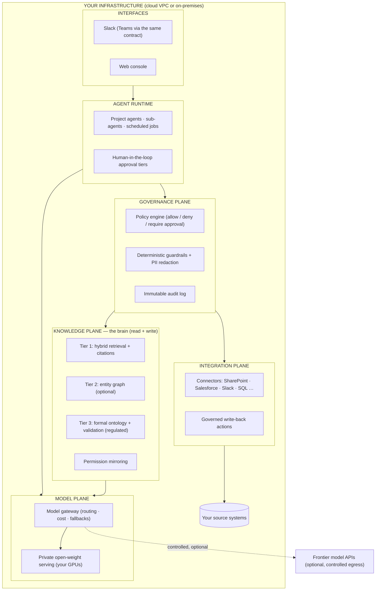
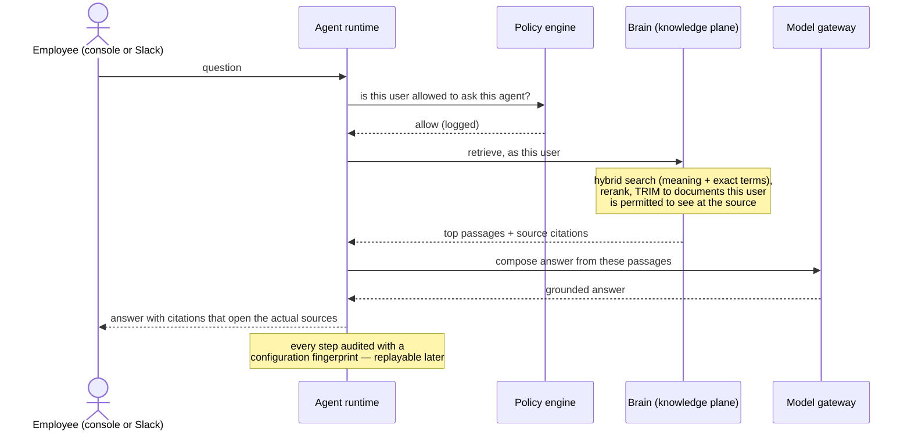
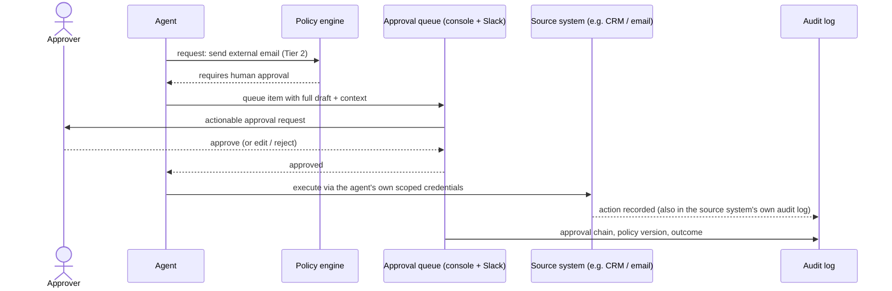
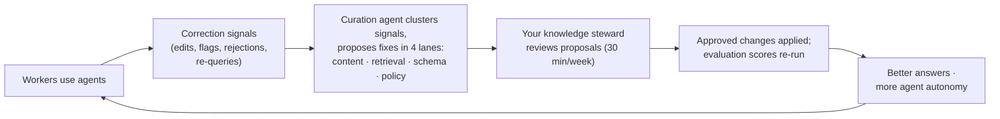
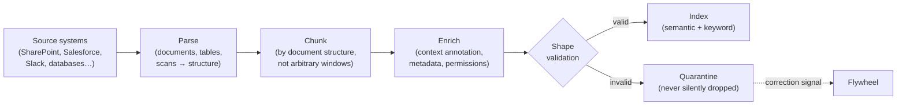
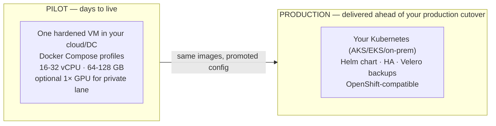

# Neutron Enterprise — System Architecture

**AI in production, in your infrastructure, never locked to a vendor.**

Version 1.1 · July 2026 · Ryan Junee

*This document walks from zero assumed knowledge to full technical depth. Part I is for executives and budget owners. Part II shows how the system behaves in daily use. Part III explains each layer and why it exists. Part IV is the technical reference for architects and security teams.*

---

# Part I — Why this exists

## The problem: most enterprise AI never ships

An MIT study made headlines by finding that ~95% of enterprise generative-AI pilots produce no measurable P&L impact. Whatever the exact number, the *failure pattern* it documented is consistent and recognizable:

1. **No knowledge foundation.** The pilot answered from a thin, stale slice of company knowledge — so it hallucinated, or missed the obvious, and people stopped trusting it.
2. **No measurement.** Nobody could say how accurate the system was, so nobody could see it degrading — until users quietly stopped using it.
3. **No governance.** Without permissions, audit trails, and human approval where it matters, the system either couldn't be trusted with anything real — or it was, and shouldn't have been.
4. **No improvement loop.** The tools couldn't retain feedback or adapt. A pilot frozen at day-one quality decays; usage falls; the project dies.

The model was never the hard part. Everything *around* the model is the hard part.

## From assistants to outcomes — why this is a different class of system

Most people's mental model of workplace AI is a chat window. That model is already two generations old. Workplace AI is evolving through three distinct stages:

1. **Tools that assist — "help me."** ChatGPT, Claude, Copilot. Genuinely useful — but the person still does the work: brings the context, checks the output, carries the result to where it's needed. Nothing is remembered between conversations; nothing compounds. Value is capped at per-seat productivity.
2. **Agents that execute — "do this for me."** AI that completes defined tasks end-to-end. A real step up — but an agent without deep company knowledge is confidently wrong, and an agent without governance can't be trusted with anything that matters. This is the stage where most pilots stall.
3. **Systems that own outcomes alongside your team — "own this with me."** The stage this platform is built for. The system retains context across every interaction, develops genuine expertise in your specific business, and operates autonomously inside boundaries you define. It doesn't just respond to prompts — it anticipates recurring needs, learns from every correction, and improves continuously. The right analogy is a great new hire: modest on day one, indispensable by month twelve — except this hire's knowledge stays when people leave, and every action it takes is logged.

The difference between stage 1 and stage 3 is not a bigger model — it is everything around the model. That is what the rest of this document describes:

| | A frontier chatbot (stage 1) | Neutron Enterprise (stage 3) |
|---|---|---|
| **Context** | starts blank every conversation | a governed, permission-aware brain built from your systems, plus agent memory that accumulates |
| **Knowledge** | the public internet | your documents, CRM, tickets, databases — with citations |
| **Action** | writes text you copy-paste | executes in your systems, under approval tiers |
| **Accountability** | nobody logs what was asked or done | every retrieval, decision, and action audited and replayable |
| **Improvement** | static between vendor releases | measurably better every week via the correction flywheel |
| **Measurement** | anecdote | scored against your expert-approved test set; KPI dashboards |
| **Where it runs** | the vendor's cloud | your infrastructure |

Frontier chatbots are useful — many of your employees already use them, sanctioned or not. This platform is not a substitute for them; it is the layer they cannot be: your data, your workflows, your controls, compounding in your favor.

## What Neutron Enterprise is

Neutron Enterprise is a modular platform that supplies exactly the four missing pieces — deployed entirely **inside your own infrastructure** (your cloud account or your data center), assembled from vetted open-source components plus custom Neutron Enterprise modules delivered to you as full source, and **tailored to your specific business**: your systems, your terminology, your workflows, your risk posture. It is a system built for you, not a product you adapt to.

It makes five commitments, and each one is enforced by architecture, not by policy documents:

| Commitment | How the architecture enforces it |
|---|---|
| **1. Runs in your infrastructure.** Your documents, data, and every piece of platform state stay inside your network. | Every component self-hosts. Every outbound connection — AI model APIs through one controlled gateway, data connectors, external tool calls — is deny-by-default allowlisted, policy-checked, and audited, because any of them could carry data out; and the model-API connection can be switched off entirely in favor of models hosted on your own GPUs. |
| **2. Grounded, measured answers — and it never guesses.** Every answer cites its sources; retrieval quality is scored against a test set your experts sign off on; and when the evidence is insufficient, the system says so and escalates to a person instead of answering. | A search pipeline that combines meaning-based and exact-term matching, citations on every answer, a deterministic grounding gate that checks every generated answer's numerals, identifiers, citations, and named entities against its cited evidence, and an evidence-sufficiency gate that prefers "this needs a human" over a plausible guess — plus a test harness that blocks any change that makes answers worse. |
| **3. Agents that act — under your control.** AI can update your CRM, draft customer emails, file tickets — with humans approving what matters. | A four-tier approval model enforced by a policy engine, not by convention. Every action is attributable, auditable, and replayable. |
| **4. Improves every week.** The system at month 12 is materially better than at day 1. | Every correction your team makes becomes a signal; a curation process turns signals into reviewed improvements to knowledge, retrieval, and policy. |
| **5. Never locked to one AI vendor.** | Every generative model call goes through a routing layer. Swapping model providers is a configuration change verified by an evaluation run — demonstrated live in every deployment. |

## What you own

With the platform deployed in your environment, you own: **all data**, **all configuration**, **the complete audit history**, and **the open-source components** the platform builds on. The Neutron Enterprise modules are open source under the **Apache License 2.0** — yours to read, run, modify, and keep indefinitely. There is no dependency on any external infrastructure: the platform keeps running with no upstream maintainer involved.

Just as important is what you **don't** pay for: there are no cloud or SaaS services in the loop — the only external service is the frontier-model provider, and only if you choose to use one. And there are no per-seat licenses and no platform subscription. Your recurring costs are your own infrastructure, whatever model usage you choose, and — optionally — a maintenance agreement under which the system keeps being tuned and improved for you (Part II describes that improvement loop). The maintenance agreement is genuinely optional: the platform is yours to operate either way.

## Why "modular" matters commercially

The platform is a set of loosely coupled modules behind stable interfaces. This is not an engineering nicety — it is what makes the following possible:

- **Right-sizing.** A department pilot and a regulated-industry deployment run the same platform with different modules switched on. You pay for — and operate — only what your use case justifies.
- **Component swaps without rebuilds.** The search index, the rules engine, the monitoring stack — even the AI models themselves: each sits behind a contract and can be exchanged as the landscape shifts.
- **An upgrade path instead of a rip-and-replace.** The knowledge layer has three tiers (explained in Part III). Moving up a tier is an additive deployment, not a migration.

---

# Part II — The system in daily use

## The big picture

Everything inside the box runs on your infrastructure. The single dotted line is the only data that ever leaves — calls to frontier AI models — and it is optional, inspected, and can be eliminated entirely. The console ships in every deployment; the Slack/Teams interface shown above is built and verified, and is composed into a deployment when the rollout channel calls for it (§3.1).

## A question, answered

What happens when an employee asks *"What did we commit to in the Acme renewal, and who approved the discount?"*

Three properties matter here:

- **Grounded:** the model is only allowed to answer from retrieved company content; every claim links to its source document.
- **Permission-aware:** retrieval is trimmed to what *this* user could open in SharePoint, Salesforce, etc. Nobody learns secrets through the AI they couldn't access directly.
- **Replayable:** the audit trail records what was retrieved, which model and configuration produced the answer — so "why did the system say X in March?" has a deterministic answer.

## An action, taken

What happens when an agent wants to *do* something — say, send a drafted response to a customer:

Actions are classified into four tiers — the tier decides the control, and the policy engine enforces it:

| Tier | Action class | Control |
|---|---|---|
| 0 | Read / internal draft | autonomous, logged |
| 1 | Low-risk internal writes (CRM notes, internal tickets) | autonomous + human reviews a daily digest |
| 2 | External-facing or touching personally identifiable information (PII) — customer emails, quotes | a human approves each item |
| 3 | Financial / legal / irreversible | named approver + a second independent check |

New agents start one tier stricter than their target and **earn** autonomy with a clean track record — promotion is a logged, data-driven decision, not a judgment call.

Review itself is designed against rubber-stamping: approvers see the underlying evidence before the AI's conclusion, lower-confidence items are routed to reviewers first, and seeded audit items continuously measure real catch rates — so "human-approved" remains a genuine control, not a click.

## The week-over-week improvement loop

Nothing self-mutates: every proposed change is a reviewable diff a named person on your side approves. The compounding effect is the point — the golden test set (the expert-approved exam the system is graded against) grows, retrieval sharpens, policies tune, agents get promoted. **This loop is why the system is worth more at day 365 than at day 1, and it is the piece the failed-pilot pattern always lacks.**

---

# Part III — The layers, and why each exists

## 3.1 Interfaces — meet people where they already work

**What it is:** a Slack adapter and a web console, with Microsoft Teams served through the same adapter contract when your rollout channel requires it. Agents are reachable in the channels where teams already live; approvals arrive as actionable messages; daily digests post to team channels. The console adds the power surfaces: full chat with any agent, knowledge search, the approval queue, the audit viewer, and dashboards. The console is wired end-to-end against the running backend that serves it: it authenticates a real user and serves live, governed data — including inside a fully sealed, no-egress deployment (see §4.1). The Slack adapter is built and verified as a signature-verified governed ingress module but is not yet composed into the shipped application image; it joins a deployment when the rollout channel calls for it.

**Why it matters to the business:** adoption is the whole game. Employees already use consumer AI tools in the shadows; the winning move is a *better* tool inside their existing workflow, not another portal to forget. The bar the deployment is designed against is higher than "adopted": the system should make the workday feel genuinely different for the people who use it — that is what sustains usage after the novelty fades, and sustained usage is what feeds the improvement loop and, ultimately, the KPI. The console is also where the dashboards you take to the board live: KPI trends, evaluation scores, audit evidence.

**Design choices:** all chat surfaces implement one adapter contract, so adding a channel never touches platform logic. Approvals are mirrored: the console queue is the system of record, chat surfaces are convenience mirrors.

## 3.2 Agent runtime — long-running colleagues, not one-shot chatbots

**What it is:** the execution layer for agents. Three shapes of work:

- **Project agents** — persistent, per-department or per-function; they accumulate context over months.
- **Sub-agents** — typed, short-lived workers a project agent dispatches in parallel (research, drafting, data pulls), with strict depth and concurrency limits and isolated memory.
- **Scheduled jobs** — cron-driven autonomous work (morning briefs, queue processing, report generation), each run isolated with its own permitted toolset.

Agent state lives in durable workflows on PostgreSQL: if a node restarts mid-task, work resumes rather than vanishing. Pending approvals survive restarts for the same reason.

**Agent memory:** agents record what they learn — decisions, outcomes, which proposals your steward rejected — in an episodic store with timestamps and provenance. Durable learnings get promoted into the knowledge plane through the same curation gate as everything else. Agents genuinely improve with tenure.

That promotion extends to procedure, not just fact: when an agent completes a genuinely repeatable piece of work, it can become a reusable, governed **skill** — a saved procedure other agents can invoke. A skill only enters the active library after it clears a worthiness bar (the work must have actually succeeded and been a real multi-step procedure, not a one-shot), is ranked against everything else in the queue by how often it recurs and how many different people it served, passes an automated routing check, and is approved by your steward, exactly like every other flywheel proposal; near-duplicate skills are folded into updates of the same skill rather than left to multiply, and skills that stop being used are retired, never silently left to rot the library.

**Why it matters to the business:** the difference between a demo and an operation is durability and accountability. Long-running agents amortize context; scheduled agents do work while nobody is watching; and everything they do is attributable and interruptible.

**Design choices:** built as a thin, owned composition layer over two vetted MIT-licensed libraries (typed agent framework + durable-workflow engine on PostgreSQL) rather than adopting a monolithic agent framework. The layer we own is precisely the layer enterprises need and frameworks paywall: policy enforcement, audit, approvals, identity.

## 3.3 Governance plane — trust as architecture

**What it is:** three enforcement mechanisms that stand between every agent and every consequence:

1. **Deterministic guardrails (before any model judgment):** hard spend caps, rate limits, egress allowlists, outbound-recipient allowlists, PII-field denylists, tool-argument validation. These are code, not prompts. Prompt instructions are UX; policy denials are security.
2. **Policy-as-code:** every tool call — no exceptions, no bypass path — passes a policy decision point that answers allow / deny / require-approval, with the policy version recorded. Policies are versioned files, reviewed like code.
3. **Scoped agent identity:** every agent gets its own service identity per system — its own CRM user, its own database role — never a shared admin credential. Least privilege is enforced at the source system *and* the policy engine, so every action is attributable twice. The scheduled, governed rotation sweep that ages these credentials out — using the same audited job mechanism as everything else the system does on a timer — is wired and always-on, so rotation holds by construction rather than by someone remembering to do it.

On top of source-system permissions, an **optional, off-by-default sharing layer** — a relationship-based access-control model (ReBAC), built on the open-authorization server OpenFGA — lets someone who can already see a document extend visibility to a colleague the source system's access list never named — closing the real gap where a source ACL is too coarse to express who should actually see something, without waiting on a re-index. This channel is strictly additive: it can only widen who can see a document beyond the source grant, never narrow or override it, and every grant or revocation is itself policy-checked, audited, and reversible. By default it fails closed — if the sharing service is ever unreachable, the extra visibility it grants simply disappears rather than either blocking access or (worse) leaking it; a stricter deny-on-outage posture, which blocks access instead of quietly dropping the extra grants, is configurable per deployment.

**The audit trail** is append-only and tamper-evident: each record carries a hash of the previous (any alteration breaks the chain), with periodic signed checkpoints archived to write-once storage. Every answer records which sources produced it; every action records its approval chain, policy version, and model configuration. The design assumption is that prompt injection *will* happen — and that a fully hijacked agent still cannot execute a Tier-3 action without a human.

**Why it matters to the business:** governance is what turns a compliance review from a blocker into a checklist you can pass. Your security team gets scoped credentials, deny-by-default policy, and a tamper-evident log they can verify themselves. Regulators get deterministic answers to "show me." And your leadership gets AI that can act without anyone lying awake at night.

## 3.4 Knowledge plane — the brain (read *and* write)

**What it is:** the layer that turns scattered company knowledge into grounded, cited, permission-aware answers — and accepts governed writes back into it.

### The ingestion pipeline

Every chunk carries rich metadata — source system, author, date, department, and crucially **who is allowed to see it**. Invalid data is quarantined loudly, never dropped silently: silent data loss is how knowledge systems rot.

### Retrieval: hybrid, reranked, cited

Pure "semantic search" embarrasses itself on part numbers, personal names, error codes, and contract clause IDs. The pipeline therefore always runs two searches — **semantic** (meaning-based) and **exact-term** (keyword) — fuses the results, then applies a **reranking model** to put the best evidence first, and answers only from that evidence, with citations. This combination is worth roughly a 15–30% improvement in retrieval precision over naive vector search, and it is the single cheapest quality win in the whole system — which is why it is the *floor* here, not an upgrade.

### Permission mirroring

The brain continuously syncs *who can see what* from your source systems (e.g. SharePoint access-control lists, group memberships from your identity provider). At query time, retrieval is trimmed to the asking user's entitlements. **A user can never retrieve through the AI what they could not open at the source.** Permission changes propagate on a short sync interval without re-indexing content.

Where the optional ReBAC sharing layer (§3.3) is enabled, the visibility rule becomes a simple union: a chunk is visible if the source ACL grants it *or* an explicit, audited share grant names the user — never by any other path. The share leg can only add visibility on top of the source-ACL leg; it has no mechanism to subtract from it, so the "never see what you couldn't open at the source" guarantee above holds exactly as stated for every deployment, whether or not sharing is turned on.

### The three-tier ladder

| | What it adds | When it's justified |
|---|---|---|
| **Tier 1 — Hybrid retrieval** | everything above | every deployment, day one |
| **Tier 2 — Entity graph** | your CRM/ERP/HR systems already *are* a graph (accounts→contacts→orders→tickets). Loading them as typed entities and relationships enables multi-hop questions ("which customers are affected by the change to product X via contract clause Y") and org-wide sensemaking. Entity resolution is statistical and review-gated — no hallucinated relationships. | when the question inventory shows multi-hop and relationship questions |
| **Tier 3 — Formal ontology** | standards-based typing (ISO/IEC 21838-2 upper ontology), machine-checkable validation shapes at every write, auditor-grade provenance. When a regulator says *show me*, a typed graph answers deterministically. Includes a **verified-answers mode**: structured questions are answered by pre-approved query templates over the validated graph — the AI never generates the fact, so this class of answer cannot be fabricated, by construction, and every one is replayable. | regulated environments: GxP, BCBS 239, HIPAA-clinical, defense |

One schema source generates the contracts for all three tiers, which is what makes upgrading **additive** — a Tier-1 deployment's investment carries forward; nothing is thrown away.

> **Status:** All three tiers are built and verified, not just Tier 1. **Tier 2 (entity graph)** runs on Apache AGE with the same permission-trimming applied at every hop of every traversal, a statistical entity-resolution stage that proposes (never silently auto-applies) merges of duplicate records, and citations that trace back through the graph path. **Tier 3 (formal ontology)** validates every write against BFO/CCO-typed SHACL shapes before it is stored, and answers structured questions through pre-approved, verified query templates over that validated data — never generated text — so that class of answer cannot be fabricated. What does remain a deliberate non-goal today is having a model *decide what to extract into the ontology* from unstructured text; that pathway is designed but intentionally not built, so Tier 3 currently ingests only from structured and semi-structured sources. Tiers remain additive — a Tier-1 deployment's investment carries forward — and Tier 2/3 are switched on when the question inventory justifies them (see §4.4).

**Why it matters to the business:** the brain is the difference between "a chatbot that sounds confident" and "a system whose answers your team verifies once and then trusts." Right-sizing the tier to the actual question inventory — diagnosed during the audit phase, not assumed — is why you don't pay ontology prices for FAQ problems.

## 3.5 Integration plane — where the value actually forms

**What it is:** the connectors and action tools that wire the platform into your estate. Two data paths, deliberately distinct:

1. **Knowledge path (into the brain):** scheduled, incremental synchronization from SharePoint/M365, Salesforce, Slack, and SQL databases — including their permission models — with the connector set growing from your source-system inventory. Each source is governed by a one-page **data contract**: owner, schema, freshness SLA, sensitivity classification, permission model. Where a use case genuinely needs sub-minute freshness, an optional, off-by-default change-data-capture add-on streams row-level source-database changes through this exact same governed, permission-aware ingestion path — never a side channel that bypasses it.
2. **Action path (into your systems):** live, governed write-back — create the CRM note, update the ticket, draft the email — executed through each agent's own scoped credentials, under the approval tiers, using the open **Model Context Protocol (MCP)** as the tool interface. Truth stays in the source system; the platform never becomes a shadow copy of record. This path is verified against reality, not just tested against a fixture: a governed CRM write has been exercised end-to-end against a live vendor sandbox — proposed, held for human approval, approved, and landed as a genuine record in the target system.

**Why it matters to the business:** integration depth is the single strongest predictor of whether AI produces P&L impact — the failed-pilot pattern is, at root, an integration failure. It is also where the durable advantage forms: a platform woven into your systems, tuned by your usage, is an asset a competitor cannot install fresh.

## 3.6 Model plane — model-independence as engineering, not slideware

**What it is:** one gateway through which every generative model call passes, plus an optional private serving stack for open-weight models on your own GPUs.

- **Per-task routing:** judgment-heavy work goes to a frontier model; classification and extraction go to a fast, cheap one; each task's model is configuration.
- **Two lanes:** the **frontier lane** (OpenAI, Anthropic, Google, or your Azure OpenAI tenancy — through controlled egress) and the **private lane** (open-weight models served on your GPUs, inside your network). Projects and data classes can be pinned to the private lane.
- **Air-gap mode (`AIR_GAP=true`):** one flag disables all external egress, platform-wide, provably — running entirely on self-hosted models. The seal is CI-proven end-to-end for the **whole running application**, not just its infrastructure: a real installer brings up the full stack — API, worker, console, brain, and open-weight model-serving — in sequenced phases within one sealed network namespace (a CI-runner resource constraint, not a capability gap; the seal is re-asserted at every phase), a real user logs in and reaches the console, and the frontier lane is demonstrated dead. This is engineered and tested on every change, not an aspiration.
- **The model menu is curated and tagged** — every entry carries its license and country-of-origin, with a capability-first default menu and a Western-origin alternate for procurement-sensitive environments.
- **Cost tracking** per call, per task, per agent — visible in the dashboards down to the individual model call, alongside the token counts behind it.
- **Provenance on every call:** each model call is stamped with the exact configuration fingerprint (`config_hash`) that produced it, so "what produced this" is answerable deterministically later. On the frontier lane specifically, outbound content passes through fail-closed redaction before it leaves your network — a redaction failure blocks the call rather than sending unredacted content. A context-window budget is enforced honestly: when an answer would need more context than the configured budget allows, the system truncates and says so, rather than silently dropping evidence.

**Why it matters to the business:** the frontier shifts every quarter. Here, a model swap is a configuration change followed by an evaluation run that proves parity — and the evaluation run is part of the repository. You keep permanent leverage over your largest AI line item.

## 3.7 Accuracy & reliability — measured, gated, and honest

**What it is:** the evaluation harness that makes quality a number instead of a feeling.

- **The golden set:** 100+ real questions from your teams, each with a verified ideal answer and the sources that should support it. Your subject-matter experts sign it; it becomes the acceptance contract. A permanent regression suite built the same way runs this exact gate discipline over a committed 100-question reference set in continuous integration on every single code change — with deterministic CI stand-ins for the embedder and judge, so the gate wiring and thresholds can never silently stop being enforced; the same suite against the real embedder/reranker and a cross-family judge runs on the live stack, not only when a customer's own golden set is re-run.
- **Gates, not dashboards:** retrieval recall, answer faithfulness (is every claim supported by the retrieved sources?), and context precision are scored on every change — a configuration change, a model swap, a schema update. **A change that regresses the golden set does not ship.** Reference gate thresholds: retrieval recall@10 ≥ 0.85, faithfulness ≥ 0.80, permission tests 100%.
- **Verified answers come first.** For structured questions, the system checks whether the fact is already answerable from the validated Tier-2/3 data *before* it lets a model generate anything. When it is, the answer is assembled from a pre-approved query template over that validated data, not from generated text — this class of answer cannot be fabricated, by construction, and is fully replayable.
- **The system never guesses.** Accuracy is engineered per answer class. Document answers must clear an **evidence-sufficiency gate** before generation — below the bar, the system abstains and escalates *with* its evidence and reasons, never silently. Generated answers then pass a **deterministic grounding gate**: every numeral, identifier, citation, and named entity in the answer must be contained in the cited evidence — this check always runs, regardless of configuration. A separate, configurable strictness tier governs how literally the surrounding prose must track its sources; the default is the strict setting, and a looser tier is an explicit, deliberate per-deployment choice, never a silent default. Failures abstain rather than ship.
- **Contractual error bounds, not vibes.** Per-deployment calibration turns the abstention threshold into a statistical guarantee — *at most X% error on the questions the system answers* — measurable, auditable, and suitable for an SLA. Accuracy is then managed as a visible coverage/precision trade: the dashboard shows what share of questions are answered directly, the measured precision on those, and both trending upward as the improvement loop grows coverage while the bound holds.
- **Judging is disciplined:** scoring rubrics are versioned; automated judges are calibrated against human grading, and re-calibrated whenever the judge or rubric changes; judging models come from a different family than answering models to avoid self-grading bias.
- **Full observability:** every model call, retrieval, and agent step is traced (OpenTelemetry-standard), inside your network.

**Why it matters to the business:** this is what makes claims credible — including ours. The demo shows the scorecard *with the misses*: "23/25, and here are the two failures and why." It is also what makes model-independence safe rather than reckless: the eval suite is the referee for every swap.

## 3.8 The flywheel — the system that improves itself (with your hand on the wheel)

Signals are captured from day one: explicit ones (thumbs down, "wrong source" flags, rejected actions) and the implicit ones that carry most of the volume (how much a human edited a draft before sending, immediate re-queries, overrides). A nightly curation agent clusters them and routes each cluster into one of four fix lanes:

1. **Content** — a source document is stale/wrong/missing → draft the fix or flag the owner
2. **Retrieval** — the right document existed but wasn't found/ranked → tuning proposal + the failure becomes a new golden-set test
3. **Schema** — a recurring entity or relationship the model of your business can't represent → schema change proposal with matching validation update
4. **Policy** — approval friction or a near-miss → tier/policy adjustment proposal

Every proposal is a reviewable diff. A named **knowledge steward** on your side spends ~30 minutes a week approving, editing, or rejecting. Rejections are themselves signals — the curation agent learns your standards. Everything is versioned; every change can be rolled back; every eval run records the exact configuration fingerprint it tested. This loop runs end to end today, from a raw correction signal through steward review to an applied, audited change — a working mechanism, not a specified design.

**Why it matters to the business:** upfront knowledge-modeling cost is the historical killer of knowledge systems. The flywheel converts it into incremental, usage-driven refinement — and produces an improvement history (grown golden set, correction corpus, tuned schema) that is a compounding asset **you own**.

---

# Part IV — Technical reference

> **Implementation status (as of 2026-07-24).** This Part IV describes the platform's technical design as actually built, not merely as planned. The application layer is complete: the console backend and the durable worker process are both built, composed into a single application image, and reachable end-to-end — the pilot deployment brings up the full running application alongside its infrastructure and brain/model-serving lanes, and a real user can log in and reach the console, including inside a fully sealed, no-egress network. The production tier is equally real: a Kubernetes Helm chart reproduces full-platform parity (application, infrastructure, and brain/serving lanes together) — every change to the deployment surface is schema-validated with the hardening posture intact, and the application tier is installed live onto a real in-CI Kubernetes cluster through the same image-digest flow a production install uses, with the brain/serving data-plane live-validated in the sealed no-egress lane; Terraform references exist for both Azure AKS and a hardened AWS EKS deployment with a dedicated key-management plane, default-deny network-level egress control, and private cluster endpoints; and a disconnected-cluster installer packages the entire platform for fully air-gapped delivery.
>
> Every claim in this Part is held to a stated verification discipline (§4.5): code is proven correct offline on every change, and a subsystem is called **proven live** only once a run against the *real* external system it depends on — not an emulator — has gone green with its evidence read by hand. On that stricter bar, most subsystems remain open today: real deployments of the cloud reference architectures have progressed through most of a live apply, with every finding along the way tracked in the open and fixed rather than papered over — the most recent Azure apply surfaced two further findings, one already fixed (a Kubernetes-version bump) and one still open and awaiting dispatch (a storage RBAC gap) — but neither cloud target has yet completed a full green run end to end — that is scheduling and account access, not an unsolved engineering problem. A handful of honest, tracked gaps remain: database-level audit logging is not yet enabled in the pilot profile; a dedicated bridge from the audit log to a customer SIEM has not yet shipped (trace and metric telemetry export already works today); and at-rest encryption for live data volumes currently depends on the host disk rather than an application-managed key. None of these are architectural gaps — they are scoped, pre-production hardening items on a known list.
>
> Individual claims below are annotated only where a genuine gap remains; unannotated claims are built and verified.

## 4.1 Topology, deployment tiers, and network posture

**Form factor:** modular monolith — module boundaries are code contracts, not network hops. Two platform processes plus infrastructure services:

| Process | Contains | Status |
|---|---|---|
| `ne-api` | console backend, knowledge read/write, model gateway, identity middleware (stateless, scalable) | **built** |
| `ne-worker` | durable agent runtime (workflows, schedulers), the flywheel, connector-sync and credential-rotation jobs, event export | **built** |
| infra services | PostgreSQL, Qdrant (vector), Keycloak (SSO broker), OPA (policy), optional OpenFGA (fine-grained sharing), text-embedding/rerank inference, vLLM (GPU profile), Caddy (TLS ingress), OpenTelemetry collector, optional trace UI | **built** — pilot Compose (application + infra + brain + serve) |

Ingestion is not a separate process: it runs as governed, scheduled connector-sync jobs inside `ne-worker`, sharing the same durability and audit guarantees as everything else the worker does rather than needing a standalone service that could fail independently.

**Module inventory (for architects tracing a capability to its code):** both processes are assembled from independently-versioned, contract-bound libraries, each swappable behind its own interface (§4.4) and independently tested — the durable runtime and workflow engine (`ne-runtime`); the brain's three tiers (`ne-brain`, `ne-brain-graph`, `ne-brain-ontology`); the model gateway (`ne-gateway`) and its private-serving profile (`ne-serve`); the policy/guardrail engine (`ne-govern`) and the network egress/air-gap guard (`ne-net`); the audit and secrets layers (`ne-audit`, `ne-secrets`); identity and permissions (`ne-identity`, `ne-permissions`), with the optional fine-grained sharing extension in `ne-permissions-rebac`; source-system connectors (`ne-connect`); the flywheel (`ne-flywheel`); the evaluation harness (`ne-eval`); observability (`ne-obs`); the typed event/outbox layer (`ne-events`); schema codegen shared across all three brain tiers (`ne-schema`), with engagement-time schema discovery — bounded sample profiling and deterministic candidate-model inference, no model in the loop — in `ne-schema-bootstrap`; the governed skill library (`ne-skills`, with a Claude-Code-compatible binding in `ne-skills-cc`); the MCP tool-calling seam (`ne-mcp`); temporal agent memory (`ne-memory-graph`); the signed WORM archival adapter (`ne-storage`); the Slack chat adapter (`ne-chat`, built and verified standalone as a governed ingress module, not yet composed into the shipped application image — see §3.1); the web console frontend (`ne-console`); and the cross-module contracts every one of the above is built against (`ne-contracts`).

Cross-process communication is limited to: policy checks, inference services, telemetry export, and the database (typed events travel via a transactional outbox — no message broker required at pilot scale).

**Install tiers, identical container images:**

> **Status:** the pilot Compose stack ships the full running application — the console backend, the durable worker, and the console itself — alongside infrastructure and the brain/model-serving lanes, on one application image. The production Helm chart installs that same application image onto a real Kubernetes cluster in continuous integration — "same image, promoted config" is a working promotion path today, not a design — and the cloud Terraform references have been exercised by real applies whose findings were fixed rather than papered over, though neither cloud target has yet completed a fully green end-to-end run (see the status note above).

**Reference environment:** Azure (the most common enterprise cloud estate): VM or AKS inside your VNet, Private Endpoints, Entra ID as identity provider, egress restricted by allowlist. Nothing depends on Azure — the same profiles deploy to AWS, GCP, or bare metal.

**Network posture:** deny-by-default egress. Every sanctioned outbound flow — the model gateway's frontier lane, connector pulls, external tool calls — is allowlisted, policy-checked, and audited, because any of them can carry context out; `AIR_GAP=true` removes external egress entirely and is CI-verified end-to-end on every change: the full running application — API, worker, and the brain/model-serving stack — installs and operates in sequenced phases within one sealed no-egress network namespace (phased for CI-runner capacity, with the seal re-asserted every phase, not a capability gap), a real login succeeds inside that namespace, and the frontier lane is proven dead.

## 4.2 Identity, secrets, and deployment isolation

- **SSO:** Keycloak in **broker mode only** — your Entra ID/Okta remains the identity provider of record, federated via OIDC/SAML; every platform service trusts only the local issuer. Just-in-time provisioning maps IdP groups to platform roles. SCIM provisioning is a fast-follow add-on.
- **Secrets:** a single store interface (Vault-KV-compatible) — file/KMS-backed at pilot tier, OpenBao service in production, or your existing Vault Enterprise.
- **Agent identity:** per-agent service principals and credentials, issued and rotated through the secret store, with per-source-system accounts.
- **One customer, one deployment:** custom software in your own environment — there is no other tenant by construction. There is no multi-customer control plane, no shared state, structurally.

## 4.3 Audit & replay mechanics

Append-only PostgreSQL event tables; each record embeds a SHA-256 of its predecessor (tamper-evidence verifiable with SQL); signed checkpoints are archived to WORM/object-lock storage automatically on a schedule, not as a manual operator step. This archival layer is proven, not just designed: a live run against real AWS S3 Object Lock and real Azure immutable blob storage confirmed checkpoints land correctly and resist alteration or deletion before their retention period expires, with the evidence read by hand rather than taken on trust — it is the one subsystem in this document we can currently call proven against real infrastructure end-to-end (see §4.5). Database-level audit (pgAudit) beneath *(pgAudit support ships in `ne-audit` but is **not enabled in the pilot profile** yet — a documented pre-gate hardening item)*. Every event carries `config_hash` — a fingerprint of the fully-resolved configuration (models, retrieval settings, policy bundle version, schema version, prompt versions). Replay = event + config_hash → exact reconstruction of what the system knew and how it was configured.

## 4.4 Component reference (defaults; every slot swappable by contract)

| Slot | Default | Notes |
|---|---|---|
| Document parsing | Docling (+ vision model for scans/layout) | table-structure aware |
| Embeddings | Qwen3-Embedding served via TEI (dense) + BM25 sparse encoding | runs CPU or modest GPU, in-network |
| Vector store | Qdrant (server-side hybrid fusion) | pgvector alternate for Postgres-first estates |
| Reranker | Qwen3-Reranker / bge-reranker (latency tier) | in-network |
| Entity graph (T2) | Apache AGE on your PostgreSQL + statistical entity resolution (Splink) | Neo4j alternate · built |
| Ontology (T3) | Embedded triple store (default) + Apache Jena Fuseki as an out-of-process production backend, both behind a SHACL validation gateway + BFO-2020/CCO | LinkML single-schema source across tiers · built |
| ReBAC sharing (optional) | OpenFGA | additive-only fine-grained share grants, disabled by default |
| Policy engine | Open Policy Agent (sidecar) | Cedar alternate behind the same interface |
| PII detection | Microsoft Presidio | redaction stage in guardrails |
| Agent framework | Pydantic-AI + DBOS durable workflows (PostgreSQL) | thin owned composition layer |
| Model routing | LiteLLM library embedded behind our gateway interface | pinned + hash-verified; local cost map |
| Open-weight serving | vLLM (structured output enforced at the server) | SGLang alternate |
| ELT/connectors | dlt (library-first) + custom Graph-API connectors | Airbyte available as customer-choice add-on |
| CDC (optional) | Debezium Server (Kafka-free) | when sub-minute freshness is justified · built, off-by-default overlay |
| Evaluation | RAGAS metrics + CI gating harness | versioned rubrics, calibrated judges |
| Observability | OpenTelemetry (GenAI conventions) → collector; Langfuse UI optional | any OTLP backend |
| SSO broker | Keycloak 26 | brokers to Entra ID/Okta |
| Secrets | SOPS/KMS (pilot) · OpenBao (production) | Vault-Enterprise compatible |

*Alternates are validated designs behind the same contract, built into a deployment when it requires them.*

**Curated model menu (private lane):** capability-first defaults — GLM-5.x (judgment), Qwen3.5 (balanced), Qwen3.6-35B (fast/cheap) — all under MIT/Apache licenses; Western-origin alternates (Mistral Large 3, gpt-oss) for procurement-sensitive environments. Every entry carries license + origin tags. Frontier lane: Anthropic, OpenAI (incl. Azure OpenAI in-tenant), Google — per-task configurable.

**Open-source licensing discipline:** every dependency is license-vetted at its pinned version (permissive licenses embedded; copyleft only as isolated out-of-process services; no source-available licenses in the core), hash-verified, and security-screened. Each release ships a software bill of materials (CycloneDX), vulnerability scan results, and signed container images with build provenance — aligned with EU Cyber Resilience Act reporting obligations.

## 4.5 Assurance & provenance — how we prove what this document claims

A serious technical reviewer asks two questions about every claim above: *why should I believe this specific answer or action was correct*, and *why should I believe this component actually works, rather than works in a demo*. Both have concrete, checkable answers.

**Every answer and action carries provenance.** Each one is stamped with `config_hash` — a fingerprint of the exact configuration that produced it (models, retrieval settings, policy bundle version, schema version, prompt versions) — plus, for generated answers, whether it was grounded and verified and at what strictness tier. "Why did the system say X in March?" is answerable deterministically from these stamps, not from log archaeology.

**Components are proven live, not just built.** A standing internal discipline targets every non-trivial subsystem for a run against the *real* infrastructure it depends on — a real cloud account, a real authorization server, real GPU hardware, a real database connection pooler (PgBouncer) — never only an emulator, and never assumes success: a subsystem is counted as proven live only after a run against the real system has gone green and a person has read the evidence by hand. That state is tracked in a running, honest ledger (`docs/live-proof-coverage.md`) rather than asserted in prose. As of this writing, the audit-archival layer described in §4.3 is proven live against both major public clouds' immutable storage; several other subsystems are built and staged for their live run; most remain open, pending scheduling or account access this document does not pretend around. The discipline — test against reality, keep the ledger honest, never weaken a test to make a real system pass — is the actual differentiator; a claim that everything is already proven would not be.

**Shipped guarantees get adversarial review, not just a green test suite.** A standing practice has a second, independent model critique the first model's own claimed guarantees across the codebase, looking specifically for the gap between what a component asserts about itself and what it actually enforces. The most recent full pass found five such gaps and closed all five.

**Deployment shapes are tested honestly, including the ones that break something.** Pooled Postgres configurations are exercised in continuous integration against a real transaction-mode PgBouncer connection pooler, not only a direct connection — that exercise surfaced a genuine incompatibility between the pooler and a session-level safety setting the platform depends on. The finding is pinned by a reproducing test and tracked to a proper fix; a proposed workaround that would have made the connection succeed by silently dropping that safety setting was identified and explicitly rejected rather than shipped. A real managed-Postgres run of these same suites (RDS / Azure Flexible Server) is the next lane in the ledger, not yet run.

## 4.6 Security posture summary (for security-team review)

- SSO on every surface; no local accounts in production profiles
- TLS 1.2+/1.3 everywhere; encryption at rest with customer-managed keys for **backups and secrets** (envelope encryption); live data-volume at-rest encryption currently relies on host-disk encryption (a documented pre-gate item)
- Deny-by-default egress; single controlled model-API flow; provable air-gap mode
- Policy engine on every tool call; deterministic guardrails before model judgment; injection assumed in design
- Approval gates never auto-approve: items pending past SLA escalate; expired approvals require re-request; Tier-3 approval cannot be delegated below the named approver
- Evidence-gated answering with a deterministic grounding gate on every generated answer (numerals, identifiers, citations, and named entities must be contained in the cited evidence); abstentions escalate with their evidence (never silently); review workflows hardened against rubber-stamping (evidence-first display, confidence routing, seeded known-error audits, sampled second review)
- Per-agent scoped identities; no shared credentials; the optional ReBAC sharing extension is additive-only, fails closed on outage, and every grant or revocation is policy-checked and audited
- Hash-chained audit + signed WORM checkpoints — **proven live** against real cloud object-lock storage, not only built and unit-tested (§4.5); a dedicated audit→SIEM exporter is **not yet shipped** (OTel telemetry export exists for traces/metrics; a shipped audit-log→SIEM bridge is a documented pre-gate item)
- Backups with tested restore drills and stated RPO/RTO; reversible migrations; semver + N-1 supported upgrades
- SBOM, image signing, provenance, vulnerability management with disclosure policy; a daily automated sweep checks every pinned dependency against newly disclosed vulnerabilities and dispatches a fix for review when one applies — a path that has already caught and shipped a critical image fix
- Fully isolated per-customer deployment (own database, keys, identity broker); your data never co-resides with anyone else's
- Third-party penetration test before first production deployment; security dossier available for questionnaire response

## 4.7 What the platform deliberately does not do

- **No shadow system of record.** Truth stays in your source systems; the brain indexes and cites, actions write back.
- **No autonomous schema/policy mutation.** Every self-improvement proposal passes a named human.
- **No unbounded autonomy.** Tier-3 actions cannot execute without a human, even under prompt injection.
- **No vendor bet.** Not on an AI lab, not on a cloud, not on any single open-source project — every slot has a named alternate behind a stable contract.

---

## Glossary

| Term | Meaning |
|---|---|
| **Agent** | A long-running AI worker with a defined role, tools, memory, and permissions |
| **Approval tier** | The 0–3 risk classification that determines whether an action runs autonomously or needs human sign-off |
| **Brain / knowledge plane** | The layer that ingests, indexes, and serves company knowledge with citations and permissions |
| **Citation** | A link from an answer back to the exact source passage in your systems |
| **Connector** | A component that synchronizes one source system (documents + permissions) into the brain |
| **Flywheel** | The weekly loop that turns usage corrections into reviewed system improvements |
| **Golden set** | The SME-verified question/answer test set that gates every change |
| **Grounding gate** | The deterministic check that every generated answer's numerals, identifiers, citations, and named entities are contained in its retrieved evidence, before the answer ships |
| **Hybrid retrieval** | Combined semantic + exact-term search, fused and reranked |
| **Live-proof ledger** | The tracked, honest record of which subsystems have been proven correct against real infrastructure, as opposed to tested only against emulators |
| **MCP** | Model Context Protocol — the open standard interface between agents and tools/systems |
| **Model gateway** | The single routing layer all generative AI model calls pass through; the mechanism of model-independence |
| **Permission mirroring** | Continuous sync of source-system access rights, enforced at query time |
| **Private lane** | Model serving on your own GPUs inside your network; no data egress |
| **ReBAC / share grant** | An optional, additive permission extension letting a document be shared beyond what the source system's access list grants; always policy-checked and audited, and never able to remove access the source system grants |
| **Skill (governed)** | A reusable procedure distilled from an agent's completed work, approved by a steward before it can be routed to again |
| **Steward** | The named person on your team who reviews the flywheel's proposed changes |
| **Tier 1/2/3 brain** | Hybrid retrieval / + entity graph / + formal ontology with validation |
| **Verified answer** | An answer assembled from a pre-approved query template over validated data, rather than generated text — cannot be fabricated, by construction |

---

*Neutron Enterprise · Apache License 2.0 · This document describes platform architecture.*
