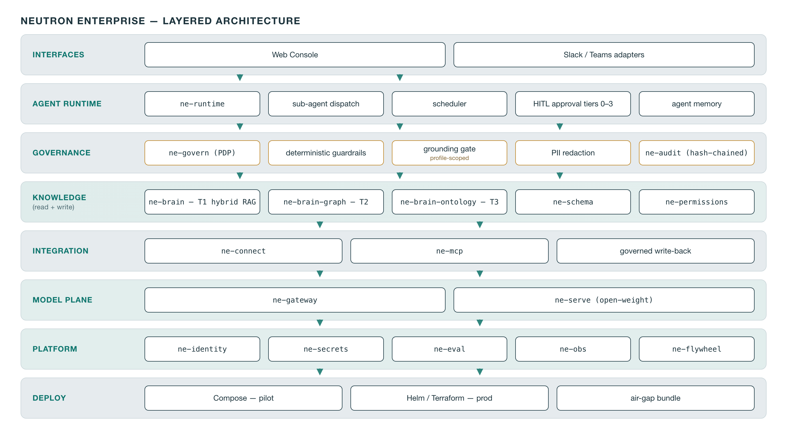
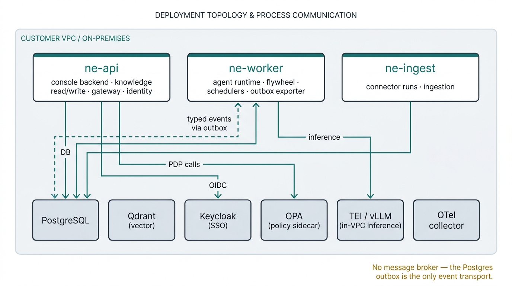
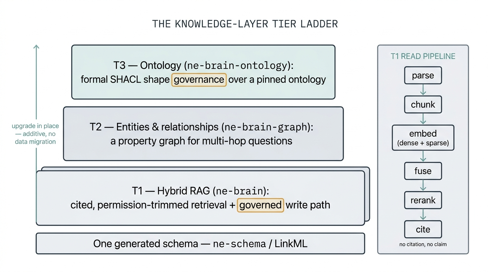
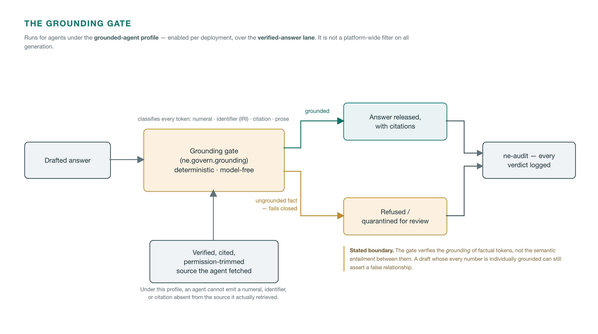
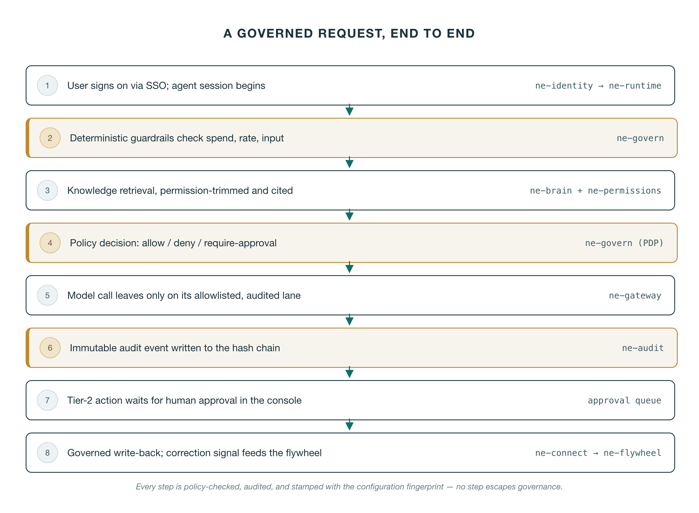
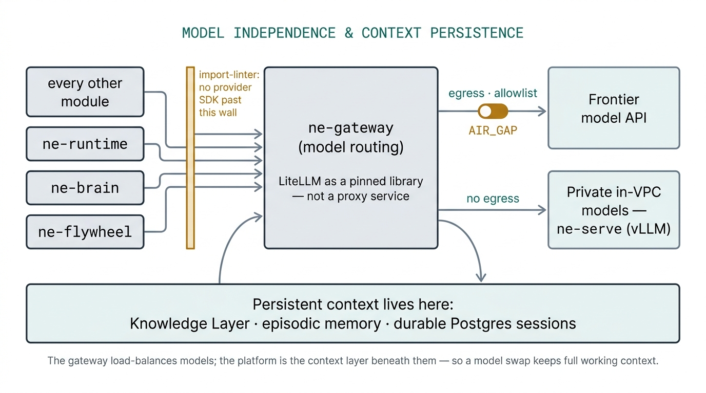

# Neutron Enterprise
> **One-line summary.** Neutron Enterprise is a modular software platform for production AI workflows, released as open source under the Apache License 2.0 and run entirely inside the customer's own infrastructure. It is model-independent by construction, governed and audited on every action, and engineered for correctness in the strictest regulatory environments.

---

## 1. Executive summary

Enterprises adopting AI face a recurring conflict. The most capable AI tooling arrives as a SaaS control plane that ingests corporate data, phones home, and locks the buyer to a single model vendor. The safest posture — keep everything in-house — usually means giving up the tooling entirely and rebuilding it from scratch for each project.

A second failure pattern has become just as visible: AI spend that rises without registering anywhere on the P&L. Widely reported 2025 industry analysis found that the large majority of enterprise AI pilots produce no measurable profit-and-loss impact — more tokens consumed, more code generated, no movement in operating cost or revenue that a CFO can point to. Individual productivity gains stay siloed on individual machines and never compound into team-level or organisational capability. The Neutron Enterprise platform treats this as an architectural problem, not a reporting afterthought. Reporting leads with named business KPIs; hours-saved is the supporting floor, never the headline.

Neutron Enterprise is built against both failure modes. It is a **suite of re-usable, composable software modules** that deploy inside the customer's own virtual private cloud (VPC) or on-premises environment. Each deployment is *assembled* from these modules rather than rebuilt. The platform delivers:

- **Sovereignty.** Every component self-hosts; there is no SaaS control plane and no phone-home. The platform makes no outbound network call except to a destination the customer has explicitly allowlisted. This is enforced at two layers: a deny-by-default network perimeter with FQDN-exact egress allowlisting, and — for every model call, data connector, external tool call, and write-back — a policy check, argument validation, and an immutable audit record. Because any outbound path can carry context out (a web-search query or a tool-call argument as much as a model prompt), the platform governs all egress the same way rather than trusting any single "safe" lane. The frontier-model API is one such governed destination; an `AIR_GAP` switch removes external egress entirely, leaving only in-VPC inference and in-VPC tools — a posture proven by a no-egress integration test in CI.
- **Model independence by construction.** No module imports a model-provider SDK directly; every generative model call routes through one gateway. Swapping GPT-class, Claude-class, or open-weight models is a configuration change, not a re-engineering project. This is enforced automatically in the build pipeline, not merely recommended — and because working context lives platform-side, it survives the swap (§6).
- **Governance and audit on every action.** Every agent tool call passes a policy decision point and emits an immutable, hash-chained audit event. There is no bypass path — the middleware that enforces this is non-optional, and an audit-completeness test asserts it. High-consequence actions require a human approver by policy.
- **A knowledge layer built for trust, not demos.** Retrieval is hybrid (semantic + keyword), fused, reranked, permission-trimmed, and cited. Every answer is traceable to its source. Knowledge flows *in* through a schema-validated, provenance-stamped write path — the store cannot be silently polluted. A deterministic **grounding gate** (§4.12) goes further still: for agents running under the platform's **grounded-agent profile**, it classifies every token of a draft answer and fails closed on **fabricated facts and figures** — any numeral, identifier, or citation not grounded in the verified, cited source the agent actually fetched. Such an agent cannot invent a number and have it reach the user. The gate's boundary is stated as precisely as its guarantee: it verifies token grounding against the verified-answer lane, not semantic entailment, and §4.12 names where it runs and the residual claim classes it does not cover.
- **Attributable economics.** Every model call emits a cost event carrying an optional business-KPI tag (C8). AI spend is traceable to tasks, departments, and named business outcomes — not aggregated into an unexplainable line item.
- **Supply-chain integrity from the first commit.** Software bills of materials, vulnerability scanning, cryptographic signing, provenance attestation, and a license gate run in continuous integration on every change.


The remainder of this document specifies how each of these properties is achieved, module by module, and maps them to the concerns of architecture, security, and regulatory review.

---

## 2. Design principles and hard constraints

The platform is governed by twelve hard constraints. These are not aspirations; they are testable invariants, and the majority are enforced automatically in continuous integration (CI) or at runtime. A change that violates one of these constraints does not merge.

| # | Constraint | How it is enforced |
|---|---|---|
| **C1** | Every component self-hosts in the customer's VPC or on-premises. No SaaS control planes, no phone-home. | Automated no-egress test in CI; dependency intake review rejects components with mandatory telemetry. |
| **C2** | All egress is deny-by-default and governed: no outbound call leaves except to an explicitly allowlisted destination, and every model call, connector, tool call, and write-back is policy-checked and audited — any egress path can carry context, so none is trusted as a "safe" lane. The frontier-model API is the model-inference egress lane; an `AIR_GAP` flag provably disables external egress (open-weight inference only). | Deny-by-default FQDN egress allowlist; per-call policy check and audit; `AIR_GAP` integration test proves the frontier path is dead while local inference remains alive. |
| **C3** | Model independence by construction: every generative model call goes through the gateway; no module imports a provider SDK directly. | Static import-linter rule in CI forbids provider-SDK imports outside the gateway package. |
| **C4** | License hygiene is gated, not assumed: vetted open-source components are the baseline default. Copyleft and non-commercial licenses are excluded from the core by default (specific classes are permitted as out-of-process services), and commercial or proprietary components can be adopted per customer through an explicit, logged allowlist entry. The gate exists to prevent accidental or unvetted inclusion — not to forbid commercial software a customer wants. | Automated license-scanner CI gate classifies every dependency at its pinned version; exceptions enter only via an explicit, recorded allowlist entry. |
| **C5** | Loose coupling: modules interact only through versioned contract interfaces and typed events. Every slot is swappable by configuration. | A contract-conformance test kit ships with every interface; an adapter passes it or it does not merge. |
| **C6** | Every agent tool call passes the policy decision point **and** emits an audit event. No bypass path exists. | Runtime middleware is non-optional; an audit-completeness test asserts one audit event per tool call. |
| **C7** | The knowledge plane is read **and** write: curation writes and governed source-system write-back are first-class, tier-enforced interfaces. | Write-path acceptance tests; shape validation on every write. |
| **C8** | KPI-first instrumentation: platform events carry an optional business-KPI tag; reporting leads with named business KPIs, with hours-saved as a supporting floor. | Enforced in the event schema and the report templates. |
| **C9** | Deploy anywhere: container images carry no cloud-provider-specific dependency. Clouds are *deployment targets*, never dependencies — hardened reference architectures, deployed into the customer's own account or subscription, are provided for AWS and Azure as first-class targets, from the same images (§11). | Image-portability review; cross-cloud portability verification in CI. |
| **C10** | Audit-log integrity: the audit log is append-only and hash-chained, so any tamper, deletion, reordering, or truncation is detectable. | Database-level append-only triggers; a SHA-256 chain over every record; a verification command that fails and names the offending record; periodic signed checkpoints archived to write-once storage. |
| **C11** | Supply-chain integrity from the first commit: SBOM, vulnerability scan, signing, provenance, pinned and hash-verified dependencies. | A suite of CI gates (described in §12). |
| **C12** | Prompt injection is assumed hostile: deterministic guardrails run in code *before* any model judgment; a fully hijacked agent cannot take a high-consequence action without a human. | Guardrails are code-enforced and pre-model; an adversarial test suite exercises them. |

**Dependency intake.** Every third-party dependency is admitted only after: OSI license verification at the pinned version; version pinning with hash verification; a vulnerability-history and known-exploited-vulnerability check; a maintainer-viability check; and confirmation that any telemetry is absent or disabled by default. The platform's design deliberately treats prominent supply-chain failures in the AI tooling ecosystem as cautionary precedent, not background noise.

These twelve constraints are the backbone of the rest of this document. Each module section below notes which constraints it upholds and how.

---

## 3. System architecture and topology

### 3.1 Layered architecture



Neutron Enterprise is organised into horizontal layers, each of which is a set of modules communicating only through typed contracts:

```
INTERFACES     Web console (React) · Slack & Teams chat adapters
AGENT RUNTIME  Durable agent loop · sub-agent dispatch · scheduling ·
               human-in-the-loop approval tiers 0–3 · agent memory
GOVERNANCE     Policy decision point · deterministic guardrails ·
               grounding gate · PII redaction   +   Immutable
               hash-chained audit · replay
KNOWLEDGE      Tiered knowledge layer (T1 hybrid RAG → T2 graph →
(read+write)   T3 ontology) · unified schema · permission trimming
INTEGRATION    Governed connectors (ingest) · MCP adapter · governed
               source-system write-back actions
MODEL PLANE    Model gateway (routing, lanes, cost) · open-weight serving
PLATFORM       Identity/SSO · secrets · evaluation · observability ·
               self-improvement flywheel · skill library (Skill Forge)
DEPLOY         Compose (pilot) · Helm/Terraform (production) · air-gap
```

Module boundaries are **Python package boundaries expressed as typed interfaces (Protocols)**, not network boundaries. This is a deliberate choice discussed in §3.3.

### 3.2 Deployment topology

The platform deploys as a **modular monolith running as three stateless-or-worker processes plus a set of standard infrastructure services**. This gives the operational simplicity of a small number of deployable units without sacrificing internal modularity.



| Process | Responsibilities | Scaling |
|---|---|---|
| `ne-api` | Console backend, knowledge read/write endpoints, model gateway, identity middleware | Stateless; scales horizontally |
| `ne-worker` | Agent runtime, self-improvement flywheel, schedulers, event/outbox exporter | Owns its durable-workflow state in Postgres; scales by adding worker processes |
| `ne-ingest` | Connector runs and the ingestion pipeline | Batch/queue driven |
| Infrastructure services | Postgres, vector store, identity broker, policy engine, in-VPC inference (embeddings, reranking, open-weight generation), telemetry collector | Standard containers |

**Cross-process communication is deliberately narrow.** The only paths between processes are: policy-decision calls to the policy engine, inference calls to the in-VPC model servers, telemetry export, and the shared database. Typed domain events travel through a **Postgres outbox table** consumed by an exporter — there is no external message broker, which removes an entire class of infrastructure and its attack surface. Any deviation from this communication model requires a recorded architecture decision.

### 3.3 Why a modular monolith

A network-of-microservices topology would multiply the number of mutually-authenticated network hops, secrets, and failure modes inside the customer's environment — increasing both operational burden and attack surface — without a corresponding benefit at the scale of a dedicated per-customer enterprise deployment. By making module boundaries *code* boundaries enforced by typed contracts, the platform keeps modules genuinely swappable (a security or architecture reviewer can verify the seam in the type system) while collapsing the runtime to three processes that are simple to deploy, observe, and secure. Where genuine process isolation is valuable — the policy engine, the inference servers — those run as separate services with narrow, typed interfaces.

### 3.4 One customer, one deployment

Neutron Enterprise is custom software deployed inside each customer's own network — there is no other tenant by construction. One customer is one deployment, with its own database, its own vector store, its own identity broker, and its own keys — a direct structural consequence of self-hosting (C1), not a separate product feature. There is no shared control plane through which one customer's data could reach another, because there is no shared control plane at all. This is the strongest possible answer to the most common enterprise-AI objection — "where does our data go?" — the answer is: nowhere it does not already live.

### 3.5 Default components and swappable alternatives

The platform is a **framework, not a product the customer adapts to**: buy-and-customise, modular, deployed in the customer's environment, with every layer swappable by contract. That claim is only credible if the components are named. The table below lists the shipping default for every slot and at least one swappable alternative — each slot is a versioned interface in `ne-contracts` (C5) with a conformance test kit, so an alternative is admitted by passing the kit, not by a re-integration project. Every component below has passed the license gate (C4) and the dependency-intake checks (§2) at its pinned version.

| Slot | Default | Swappable alternative(s) |
|---|---|---|
| Document parsing | Docling + Granite-Docling | RAGFlow DeepDoc; Unstructured / Tika |
| Embeddings | Qwen3-Embedding served via TEI (dense) + FastEmbed BM25 (sparse) | BGE-M3 (combined dense + sparse) |
| Vector store | Qdrant (server-side fusion of dense and sparse) | pgvector |
| Reranker | Qwen3-Reranker | bge-reranker-v2-m3 |
| Graph store (Tier 2) | Apache AGE, inside the customer's Postgres | Neo4j Community Edition (as an out-of-process service) |
| Ontology stack (Tier 3) | Apache Jena Fuseki + pySHACL + LinkML, over BFO-2020 (ISO/IEC 21838-2) + CCO v2.1, vendored in-repo | Oxigraph; QLever (at scale) |
| Entity resolution | Splink | Service-isolated alternatives, admitted per deployment |
| Policy engine (PDP) | Open Policy Agent (OPA) | Cedar (via cedarpy) |
| Data authorisation | OpenFGA (optional relationship-based access-control module) | — |
| PII detection | Microsoft Presidio (version-pinned, dependency-isolated) | — |
| Secrets | SOPS + customer KMS (pilot); OpenBao (production) | Any Vault-KV-v2-compatible store, including the customer's own Vault Enterprise |
| Model routing | LiteLLM, embedded as a pinned, hash-verified **library** inside `ne-gateway` — never the proxy service | any-llm behind the same gateway interface |
| Open-weight serving | vLLM | SGLang |
| Agent runtime / orchestration | Pydantic-AI + DBOS Transact (durable execution) | Temporal (a port of the durability seam); LangGraph-class libraries are governed through the same chokepoint — as an in-process binding, or **out-of-process via the platform's governed MCP surface** when the framework's dependency closure is deliberately kept out of the platform lock (as LangGraph's is, see §3.5 note) |
| ELT / connectors | dlt (library-first ELT) | Airbyte Self-Managed |
| SSO broker | Keycloak in broker mode, federating to the customer's IdP (Entra ID, Okta) | Any standards-compliant OIDC/SAML identity provider behind the broker |
| Evaluation | Native RAGAS-methodology metrics scored via the gateway judge + promptfoo as the CI gate | DeepEval-class harnesses; the RAGAS library itself is retained as a dev-only cross-validation oracle |
| Observability | OpenTelemetry GenAI semantic conventions → any OTLP backend | Langfuse (optional self-hosted profile) |

Three notes a reviewer should hold onto. First, the **agent-orchestration slot is explicitly contract-swappable**: Pydantic-AI is the default, and LangGraph-class frameworks fit the same slot behind the same typed seam — the platform's governance chokepoint (§4.14) wraps the orchestrator, not the other way round. A precise nuance for LangGraph specifically: its dependency closure (the LangChain libraries) is one the platform deliberately excludes from its own lockfile and SBOM, so the guarantee is delivered **out-of-process** rather than as an in-process binding — the customer's LangGraph agent runs in its own process, and every enterprise-effectful action it takes is routed through the platform's governed MCP surface (the same non-bypassable chokepoint). The platform thus governs a runtime it never links against; the customer keeps their open-source LangGraph unchanged, and the platform supplies the enterprise layer (the open, self-hosted alternative to the paywalled LangGraph Platform). Governance wrapping the orchestrator is the invariant; in-process binding versus out-of-process MCP is a delivery detail, not a difference in the guarantee. The one honest asterisk is the durable-execution engine, which is wrapped in thin platform decorators so that a Temporal port is a tractable exercise rather than a configuration flip. Second, v1 ships one production adapter per slot; alternates are built when a deployment needs them, and the conformance kit — not this document — is what guarantees the swap. Third, the full, named software bill of materials for each release — every component at its pinned, hash-verified version — is available to reviewers as a CycloneDX artifact (§12).

### 3.6 Brownfield coexistence — wrap, don't replace

The platform's default posture in an existing enterprise estate is **additive**: it wraps what is already there rather than replacing it. Three seams carry that posture:

- **Model tenancy.** The gateway's frontier lane points at whatever governed frontier access the customer already operates — a private model tenancy in their AWS estate, an Azure OpenAI private tenant that has already been through review, or an in-VPC frontier endpoint — while the platform itself and the open-weight lane run in the customer's own VPC on either cloud. An AWS-primary shop keeps its AWS footprint and its existing model arrangements; nothing about the platform forces a second ecosystem. One governed gateway and one audit trail span whatever combination exists (§4.3).
- **Identity.** The identity broker (Keycloak, the default deployment shape) federates to the customer's existing identity provider — Entra ID, Okta, or any standards-compliant provider — over OIDC/SAML. The broker contributes a consistent local issuer and role mapping; whether to retain it long-term or integrate platform surfaces directly against the corporate IdP is a deployment choice, not an architectural commitment.
- **Existing retrieval estates.** An existing vector/RAG deployment can sit behind the knowledge-read contract during a transition — queried through the same permission-trimmed, cited interface as the native tiers — so a prior investment coexists during migration rather than being written off on day one.

Nothing in the platform requires decommissioning an existing system in order to adopt it: truth stays in the source systems (§4.17), the knowledge plane mirrors rather than replaces them, and a deployment grows by connecting more of the estate, not by migrating it.

---

## 4. Module reference

This section walks the platform module by module. For each module we state **what it is**, **how it works**, and **which constraints it upholds**. Modules are grouped by layer. The named default component behind every slot referenced below, with its swappable alternatives, is tabulated in §3.5.

### 4.1 The contract layer — `ne-contracts`

**What it is.** The single package that defines every interface (Protocol) and every typed event in the platform. It is the seam layer that makes loose coupling (C5) real and auditable.

**How it works.** `ne-contracts` declares minimal, versioned interfaces for every swappable slot — knowledge read/write, chunk store, embedder, sparse encoder, reranker, graph store, model gateway, model registry, policy decision point, guardrail, redactor, audit sink, approval gate, agent session, tool registry, sub-agent dispatcher, scheduler, memory provider, skill substrate, chat adapter, connector, action tool, data contract, principal resolver, token verifier, secret store, object store, evaluation suite, signal emitter, and KPI recorder. It also defines the canonical event types (audit event, correction signal, shape violation, approval event, cost event), each of which carries a configuration fingerprint, an optional business-KPI tag, an actor, and provenance.

Adapters register through Python entry points; selection is configuration-driven (for example, `brain.vector_store = "qdrant"`). Each interface ships with a **conformance test kit**: an alternative implementation of a slot passes the kit or it does not merge. This is how "every slot is swappable" is guaranteed rather than asserted.

**The configuration fingerprint (`config_hash`).** At process start, `ne-contracts` computes a SHA-256 over the fully-resolved, canonicalised configuration tree — models, retrieval configuration, policy-bundle version, schema version, and prompt versions. This fingerprint is stamped on every event and every evaluation run. It is the mechanism that makes questions like *"why did the system produce this answer on 3 March?"* answerable with precision: the fingerprint pins the exact configuration in force at that moment.

Once the contract layer is frozen for a release, changes to it are additive-only and require a recorded architecture decision and a version bump. Downstream modules cannot silently change an interface another module depends on.

*Upholds: C5 (the conformance kit is the enforcement), C6 and C8 (event schema), and the auditability that C10 and §8 depend on.*

### 4.2 The schema layer — `ne-schema`

**What it is.** One authoritative data-model definition, expressed in LinkML, from which the platform generates everything else.

**How it works.** A single schema source generates: JSON Schema and typed data models (used for tier-1 metadata and contracts), typed entity contracts (used by the graph tier), and SHACL shapes plus an OWL representation (used by the ontology tier). This is the mechanism that lets the knowledge layer be *upgraded in place* across tiers without data migration: because all three tiers derive their shapes from one schema, moving from tier 1 to tier 2 to tier 3 is an additive deployment, not a re-modelling exercise.

The discipline of "shapes as contract" spans every tier: JSON Schema and expectation checks at tiers 1 and 2, and full SHACL validation at tier 3.

*Upholds: C5, C7 (validated writes), and the foundation of the tiered knowledge model.*

### 4.3 Model plane — `ne-gateway`

**What it is.** The single chokepoint through which every generative model call passes. It is the physical embodiment of model independence (C3).

**How it works.** The gateway embeds a model-routing library (LiteLLM, used as a library — pinned and hash-verified, never as an external proxy service) behind the platform's own interface. It exposes per-task model configuration, fallbacks, retries, privacy lanes, and cost tracking. A **model registry** tags every model with its license, origin, deployment lane, and capabilities, and drives per-task routing. Because *no other module is permitted to import a provider SDK* — a rule enforced by a static import-linter check in CI — the gateway is the only place a model vendor is named. Swapping models, or routing different tasks to different models, is a registry-and-configuration change.

**Privacy lanes and egress control.** The gateway enforces which lane a call may use: a frontier-API lane (the model-inference egress lane, C2) or a private in-VPC lane served by the platform's own open-weight inference. This choice governs where model inference runs; it is not the platform's only outbound path — data connectors, external tool calls, and write-backs also reach outside the environment, and every one of them is subject to the same deny-by-default egress allowlist, policy check, and audit record, because any of them can carry context out. An egress allowlist constrains the frontier lane, and the `AIR_GAP` flag disables external egress entirely, leaving only the private lane and in-VPC tools. Endpoint URLs for in-VPC inference are validated to block server-side request forgery (metadata-service addresses, private-range redirection, and credentials embedded in URLs are all rejected). The two lanes need not share an environment: the platform and the open-weight lane run in the customer's own VPC — AWS and Azure are both first-class deployment targets (§11) — while the frontier lane points at whatever governed frontier access the customer already operates: a private model tenancy in their AWS estate, an Azure OpenAI private tenant, or an in-VPC frontier endpoint. One governed gateway, one audit trail, spanning whatever combination the customer already runs. Coexistence with an existing estate — identity, model tenancy, and prior RAG investments — is treated as a first-class posture in §3.6.

*Upholds: C2, C3, and C4 (only license-clean models ship as defaults; commercial or open-weight models are registry-tagged and lane-controlled).*

### 4.4 Model plane — `ne-serve`

**What it is.** The open-weight model-serving profile that makes air-gapped and privacy-lane operation possible.

**How it works.** `ne-serve` provides a GPU serving profile built on vLLM (with a CPU-mode tiny-model variant for CI and for no-egress testing), structured-output support, weight-integrity verification, and health and throughput checks. It is what a fully sovereign deployment uses when no frontier API is permitted. Two curated open-weight menus are provided: a capability-first default, and a **Western-origin menu** (Mistral Large 3, gpt-oss) that is the **current recommended default for origin-sensitive deployments**. Every model carries an origin tag in the registry, and per-customer origin constraints are honoured by routing policy — a procurement rule such as "no models of a given origin" is a registry constraint, not a manual review burden. Serving tiers by GPU count are given in §11.

*Upholds: C1, C2 (the `AIR_GAP` open-weight lane), C9.*

### 4.5 Knowledge layer, tier 1 — hybrid RAG (`ne-brain`)

**What it is.** The retrieval tier that ships with every deployment. The user-facing name for this whole plane is the **Knowledge Layer** (also described as the *Context Engine* or *Brain*). Tier 1 is a hybrid retrieval-augmented-generation (RAG) pipeline built to be accurate and cited — deliberately *not* naive vector search.

**How it works — the read pipeline.** A query flows through six stages:

1. **Parse.** Documents (PDF, Office, HTML) are parsed *structure-aware* — headings, tables, lists, and reading order are preserved rather than flattened.
2. **Chunk.** The parsed document is split along its natural structure, so each chunk is a coherent, citable unit. An optional enrichment step prepends a one-line description of each chunk to improve retrieval.
3. **Embed.** Each chunk is turned into *two* representations: a dense (semantic) vector from a locally-served embedding model, and a sparse (keyword) vector. Dense captures meaning; sparse captures exact terms (product codes, names, acronyms).
4. **Fuse.** Both vector types live in the vector store, which fuses them server-side — combining the recall of semantic search with the precision of keyword search in a single query.
5. **Rerank.** The fused candidate set passes through a reranker that scores each candidate against the query directly, promoting the genuinely most-relevant chunks to the top. This stage is wired into the production `ne-api` read path — it is how every retrieval is served, not an optional enhancement.
6. **Cite.** The top chunks — already permission-trimmed (see §4.9) — become the model's context, and the answer carries citations back to the exact source-system identifiers. The retrieval discipline is **no citation, no claim** — and the grounding gate (§4.12) enforces the fabrication half of that rule deterministically on the answer itself, with its boundary stated there.

**How it works — the write path.** Knowledge also flows *in*. A write enters through the knowledge-write interface and is immediately shape-validated against the schema-generated checks. Valid data is stored *with provenance stamps* (where it came from, when, and by whom). Invalid data is **quarantined, not stored**, and emits a shape-violation signal that the flywheel (§4.18) can act on. The store cannot be silently polluted by malformed knowledge, and every rejection is visible rather than silent.

*Upholds: C7 (read and write are both first-class), C1 (all inference in-VPC), and the citation discipline that makes answers auditable.*

### 4.6 Knowledge layer, tier 2 — entities and relationships

**What it is.** The tier that adds a property graph of entities and their relationships, so the Knowledge Layer can answer multi-hop questions that flat retrieval cannot reach.

**How it works.** A property graph is constructed structured-first from the source systems (not hallucinated by a model), using a graph store that runs inside the customer's own Postgres. Entity resolution deduplicates and links records. A language model is used only to *link mentions to existing entities* — creation of new entities is gated by review — which keeps the graph trustworthy. Because the entity contracts are generated from the same schema as tier 1, this tier is an additive deployment on top of tier 1, not a migration.

This structured-first posture is the default and is what a deployment gets unless it deliberately chooses otherwise. §4.6a describes the one optional pathway that widens it, and the integrity floor that pathway cannot escape.

*Upholds: C5, C7, and the same provenance and review discipline as tier 1.*

### 4.6a Optional — model-proposed graph elements, under an enforced integrity floor

**Why this exists.** The structured-first rule in §4.6 is a deliberate trade: it buys a graph whose every element traces to a source record, and it pays for that by seeing only what the source systems already model. Enterprises with a large body of unstructured text — contracts, incident reports, research notes, correspondence — reasonably ask whether a language model may propose entities and relationships read out of that text. Answering "never" is a defensible engineering position but a poor architectural one: it forces the customer who needs that capability to build it outside the platform, where none of the platform's governance reaches it. The platform therefore offers it as an explicit, deployment-level choice, and constrains it rather than refusing it.

**The posture.** The pathway is **disabled by default**. A deployment that does not enable it is byte-identical to one where the capability does not exist: no new writes, no new events, no new operator surface. It is a **deployment-level configuration**, never a per-request option — an end user, an agent, or a prompt cannot turn it on. When enabled in its default mode, a model-read assertion does not enter the graph at all; it becomes a **review proposal** on the existing approval ledger (§4.15, §4.18), and a steward approves, edits, or declines it per document. Nothing reaches the graph without a human act.

**The integrity floor — what holds regardless of configuration.** The design's organising rule is that the human-vouching *point* is configurable but the integrity floor is not. Every model-proposed element, on every path, is:

- **Schema-valid.** It is validated against the same generated entity contracts as every structured record (§4.2). An out-of-schema class, relationship kind, or property is discarded and counted, not coerced into something that will validate.
- **Truthfully provenance-labelled.** It carries `source_system = "ne:llm"`, stamped by the platform rather than accepted from model output — a model that emits its own provenance, ACL, or assurance fields has those fields **ignored**, not honoured. Extracted identifiers are namespaced such that an extracted element can never collide with, or masquerade as, a structured one.
- **Permission-scoped to its evidence.** Each element inherits the access-control list of exactly the one source chunk that evidences it. Cross-document synthesis is structurally unrepresentable — assertions arrive per chunk, and re-evidencing never silently widens who can see an element. An empty ACL refuses the write outright rather than defaulting to open.
- **Audited and reversible.** Every extraction run emits immutable audit events (§4.13) tying each element to its run, its source chunk, and the model that produced it; and every element so labelled can be removed in bulk by that provenance label.

**What this guarantees — and its stated boundary.** The floor guarantees that a model-proposed element is always *well-formed, attributable, permission-correct, auditable, and removable* — and that it is always distinguishable, at the data layer, from a structured-first one. That is a meaningful guarantee and it is enforced in code, including build-time checks that fail the build if any module other than the reviewed extraction path attempts to write the extraction provenance label.

The boundary is stated with equal precision. **The floor is a guarantee about form and traceability, not about truth.** A model-proposed relationship can be perfectly schema-valid, correctly ACL-scoped, fully audited — and still wrong, because it is still a model's reading of a document. Nothing in the floor detects a plausible misreading. What catches that is the review gate: in the default mode a steward sees every proposed assertion beside the source text before it lands. A deployment that moves the vouching point later in the lifecycle is explicitly accepting that trade, and the platform records that acceptance as configuration rather than allowing it to be assumed. A security or model-risk reviewer should read this pathway as *optional, off by default, floor-constrained, and review-gated in its shipped default* — and should treat any weakening of the review point as a decision requiring the same scrutiny as any other change to who may write to the knowledge base.

**Verification status.** This pathway is exercised end to end against a live language model, a live graph server, and the governed runtime — not only against fixtures. The verified set covers all three configurations and both escalation directions: the default review-gated path from ingestion through steward approval; the flag-then-confirm path, including that a rejection reverts and produces no automatic promotion; the autonomous-write configuration with the audit trail reconstructed from the immutable events; bulk removal by provenance label, which empties model-written elements while leaving structured-first ones untouched; and — the property a reviewer will care about most — that a write derived from model-extracted context requires approval while an otherwise identical write derived from structured-first context proceeds. The model is reached over a loopback-only path, so the deployment's deny-by-default egress posture holds during verification rather than being suspended for it.

Two limits are stated rather than implied: the host-side apply step has no production HTTP caller and is invoked directly, and the packaged demonstration stack uses an in-memory graph store, so that configuration exercises routing and audit rather than graph persistence. A reviewer should read the verified set as covering the governed lifecycle and the integrity floor, and should verify graph persistence against the deployment's own configured store.

*Upholds: C5, C6, C7, C10, and the review discipline of §4.15.*

### 4.7 Knowledge layer, tier 3 — ontology and shape governance

**What it is.** The tier for regulated domains (for example, pharmaceutical GxP, banking risk aggregation, or healthcare privacy regimes), where the meaning of data must be formally governed.

**How it works.** Tier 3 adds a triple store with a **shape gateway** that validates data against formal SHACL shapes *before* it is written, backed by a pinned, industry-standard upper ontology: **Basic Formal Ontology (BFO) 2020 — the upper ontology standardised as ISO/IEC 21838-2 — together with the Common Core Ontologies (CCO) v2.1**, vendored in-repo so the tier loads with no external dependency. A validate-before-write discipline means the knowledge base cannot enter a state that violates its own formal model. Ontology versions are pinned, with a documented migration procedure for upgrades (the CCO 3.0 upgrade is a breaking change, and the procedure for it is part of the tier's design rather than an open question). As with tier 2, the shapes are generated from the one schema source, so the upgrade is additive.

This is the distinction that matters when comparing knowledge layers. A labelled property graph — entity types, properties, typed relationships — is tier 2, and it is genuinely useful for multi-hop retrieval. Tier 3 is a different kind of object: a realist upper ontology with formal axioms, where SHACL shapes are enforced as a gate rather than checked as a report, and where the meaning of a class is fixed by a published ISO-standard hierarchy rather than by local convention. Systems that stop at a labelled property graph cannot make that guarantee, however sophisticated their query layer.

*Upholds: C7, and the formal-governance requirements of regulated industries.*

### 4.8 Knowledge layer — the tier ladder in one view



| Tier | What it adds | Typical trigger |
|---|---|---|
| **T1 — hybrid RAG** | Cited, permission-trimmed retrieval; governed write path | Every deployment |
| **T2 — entities** | A property graph for multi-hop and relationship questions | Questions that require traversing relationships |
| **T3 — ontology** | Formal SHACL shape governance over a pinned ISO-standard upper ontology (BFO-2020 + CCO v2.1) | Regulated domains requiring formal data governance |

All three tiers sit behind **one** knowledge-read/knowledge-write interface pair. Tier upgrades are additive deployments, not data migrations — a direct consequence of the single-schema design (§4.2). All three tiers are implemented and operational end to end over governed HTTP: tier-1 retrieval, tier-2 graph reads, and tier-3 ontology-validated answers are live behind the same contract pair and surfaced in the console (§4.20). The knowledge-graph depth question — "start with documents, grow into ontologies" — is therefore not a roadmap: it is a configuration ladder a deployment climbs in place.

### 4.9 Permissions and security trimming — `ne-permissions`

**What it is.** The module that guarantees a user can never retrieve, through the Knowledge Layer, anything they cannot already read at the source.

**How it works.** Principals and groups are synchronised from the customer's identity provider. Each chunk is stamped with its source access-control list (ACL) as-is. At query time, the querying principal's group memberships are expanded and applied as a filter in the vector store, so retrieval is trimmed to exactly what that principal is entitled to see. Crucially, this trimming is proven to cover the **tier-1 read paths** — both search and fetch-by-identifier — with a test suite that asserts a caller who somehow knows a chunk's identifier still cannot fetch what search would hide; the same trimming contract governs graph and ontology reads.

**Revocation.** Entitlement changes propagate on the principal-sync interval, which is configurable per deployment; where the customer's identity provider emits change events, **event-driven synchronisation** applies revocations as they occur rather than waiting for the next sync. The bound is stated rather than hidden: between sync points, an entitlement revoked at source is not yet reflected in trimming, and the sync interval is therefore a deployment parameter a security reviewer should set deliberately. An optional relationship-based access-control module (`ne-permissions-rebac`, backed by OpenFGA) extends trimming to relationship-derived entitlements for customers whose authorisation model requires it.

*Upholds: C7, and the confidentiality guarantee that a security reviewer will scrutinise first.*

### 4.10 Governance — policy decision point (`ne-govern`)

**What it is.** The policy engine that adjudicates every agent action. Together with the audit log, it is the heart of the platform's governance story.

**How it works.** Every agent tool call is routed through a policy decision point (PDP) that returns allow, deny, or require-approval, along with the version of the policy bundle that produced the decision. Policy is expressed in versioned, declarative bundles evaluated by a dedicated policy engine (Open Policy Agent), and every decision is logged to the immutable audit trail. Because the runtime middleware that invokes the PDP is **non-optional** (C6), there is no code path by which an agent action reaches a tool without a policy decision. A tool that is not registered is rejected *before* execution — an unknown or injected tool call cannot slip past the governance chokepoint.

*Upholds: C6 (no bypass), C12 (policy is the enforcement point for tiered actions).*

### 4.11 Governance — deterministic guardrails

**What it is.** The code-enforced, pre-model safety layer that assumes prompt injection is already happening (C12).

**How it works.** Before any model judgment is applied, deterministic checks run *in code*: spend caps, rate limits, egress and recipient allowlists, PII redaction, and injection-resistant validation of tool arguments. One precision on the PII check: the *invocation* is deterministic — it runs on every applicable call, before any model — but the detector itself (Microsoft Presidio, version-pinned and isolated so its heavy dependencies never enter the platform runtime) is a probabilistic classifier, and no PII detector is perfect. The load-bearing control is therefore procedural: PII-touching actions are at minimum tier-2, meaning a human approves each one (§4.15); the detector reduces exposure, the approval tier bounds it. Because these run before the model and are not themselves model-driven, a fully hijacked agent still cannot exceed a spend cap, email a disallowed recipient, or exfiltrate data — and it cannot take a high-consequence (tier-3) action at all without a human. An adversarial test suite exercises these guardrails.

*Upholds: C12, C2 (egress/recipient allowlists), C9 (PII controls).*

### 4.12 Governance — the grounding gate (`ne.govern.grounding`)

**What it is.** A deterministic, model-free gate that — for agents running under the **grounded-agent profile** — stands between a drafted answer and the user and refuses to release **fabricated facts and figures**: numerals, identifiers, and citations that are not grounded in the verified source the agent fetched. It is enabled per deployment for the agents that need it (a governed analyst answering from the knowledge base is the archetype), and it grounds against the **verified-answer lane** rather than arbitrary free-text generation. Tier 1's rule "no citation, no claim" (§4.5) is a retrieval discipline; the grounding gate turns it into a hard, code-enforced verdict on the answer itself, for a precisely stated class of claims.

**How it works.** Before an answer is released, the gate classifies every token of the draft — numerals, identifiers (IRIs), citation markers, and prose — and checks each factual token against the verified, cited, permission-trimmed source material the agent actually fetched from the Knowledge Layer. When a question spans sources, the agent fetches multiple verified answer units and joins them; the gate verifies the joined result the same way, token by token. The verdict is structural and **fail-closed**: a draft containing any ungrounded factual token — a number with no source, an entity identifier retrieval never returned, a citation to nothing — is refused or quarantined for review rather than emitted, and the refusal is itself an audited event. Because the gate is deterministic code rather than a second model's opinion, it cannot be prompted around, argued with, or degraded by the very model failure modes it exists to catch. The mechanism has been hardened through multiple internal adversarial test rounds against fabricated-draft attacks.

**What the gate guarantees — and its stated boundary.** The gate eliminates a specific, high-value failure class: **fabrication**. An agent running under this profile cannot emit a numeral, an identifier, or a citation that does not appear in the verified, cited source material it actually retrieved — deterministically, fail-closed, on every answer it produces. The boundary is stated with equal precision: the gate verifies the *grounding* of factual tokens, not the *semantic entailment* of the relationships asserted between them. A draft whose every number is individually grounded can still assert a false relationship — an inverted comparison, a mis-scoped aggregation, a flipped negation. Those residual claim classes are addressed by different, named controls: the evaluation harness's faithfulness/groundedness and answer-correctness metrics (§10) measure them continuously against golden sets, and the human approval tiers (§4.15) put a person in front of any consequential action. A model-risk reviewer should read the gate as one precisely scoped deterministic control inside a layered defence — and should note that a control claiming a stated boundary is one that can pass validation, where a control claiming totality cannot.

Where other systems say "hallucinations are rare," this platform says: a fabricated number, identifier, or citation does not pass the gate, every refusal leaves an audit event you can inspect, and the claim classes the gate does not cover are named here alongside the controls that do cover them.



*Upholds: C12 (deterministic before probabilistic, applied to the answer itself), C6 (every verdict audited), and the citation discipline of §4.5.*

### 4.13 Governance — immutable audit and replay (`ne-audit`)

**What it is.** The tamper-evident record of everything the platform did.

**How it works.** Audit events are written to a **hash-chained, append-only** log in Postgres with database-level append-only triggers (optional pgAudit-based database audit logging is enabled per deployment), with periodic **cryptographically-signed checkpoints** archived to write-once object storage (WORM). The WORM target is the customer's own storage, reached through a pluggable storage adapter: **AWS S3 with Object Lock in COMPLIANCE mode**, **Azure Blob immutable storage** with a time-based retention policy, or an S3-compatible on-premises appliance. Selecting one is a configuration change, not a code change. In every case the retention is enforced by the storage service itself — the platform can only ever *extend* a retention, never shorten one — and the guarantee is verified against the customer's actual storage during deployment rather than asserted from a vendor's test environment. The chain proves internal consistency; the signed checkpoints close the remaining gap, since an attacker privileged enough to rewrite the whole table could otherwise recompute a consistent chain — but cannot forge a checkpoint without the signing key, and cannot delete one under WORM retention. A chain-verification tool detects any tampering, naming the offending record. The guarantee is **detection, not prevention**: a sufficiently privileged attacker can still destroy the database, but cannot alter it undetectably. A replay query API answers "why did the system say X on date D" by returning the exact configuration fingerprint in force and the identifiers of the retrieved context. Combined with the completeness guarantee from C6 — one audit event per tool call — this gives a reviewer a complete, verifiable, and tamper-evident account of system behaviour.

*Upholds: C6 (audit completeness), C10 (integrity), and the forensic and regulatory requirements of §8.*

### 4.14 Agent runtime — `ne-runtime`

**What it is.** The durable engine that runs agents, and the place where governance is physically wired in.

**How it works.** The runtime is a durable agent loop built on a battle-tested agent framework (Pydantic-AI) and a durable-execution engine (DBOS Transact), wrapped in thin platform decorators so the durability engine is itself swappable. Agents run as persistent, per-department sessions. The defining property: **every tool call passes through the policy decision point and emits an audit event** via non-optional middleware (C6). The runtime also provides typed sub-agent dispatch (with depth, concurrency, and memory-isolation caps), scheduled agents (each an isolated agent with its own gated toolset), and an episodic memory store — an append-only record of agent decisions, outcomes, and learned facts, with a curation-gated promotion path into the Knowledge Layer.

That promotion path is where individual productivity stops being individual. What one agent — and the human working with it — learns in the course of real work is captured as episodic memory, and the curation gate promotes the durable parts into the shared, permission-trimmed Knowledge Layer. A hard-won decision or a working pattern no longer lives in one engineer's local notes: it transfers to the squad, and to every squad that follows, under the same governance as every other knowledge write.

*Upholds: C6 (the enforcement site), C5 (durability engine behind a contract), C8 (events carry KPI tags).*

### 4.15 Human-in-the-loop approval tiers

**What it is.** The mechanism by which humans stay in control of consequential actions.

**How it works.** Every action class is assigned an approval tier, enforced by the PDP:

| Tier | Action class | Control |
|---|---|---|
| **0** | Read / internal draft | Autonomous, logged |
| **1** | Low-risk internal writes | Autonomous, with a daily human-on-the-loop digest |
| **2** | External-facing or PII-touching | A human approves each item; SLA-tracked; **never auto-approved**; expired approvals must be re-requested |
| **3** | Financial, legal, or irreversible | A named approver *plus* an independent second check (form set by policy — see below); no delegation below the named approver |

The form of the tier-3 second check is configurable per policy. E.g. the **banking reference policy requires the second check to be a second human** — not a counter-model — reflecting the reasonable position of second-line reviewers that a model should not attest to a model on an irreversible action.

Approvals are persisted as durable workflows, so they survive restarts. Pending tier-2 items that exceed their SLA escalate and notify. New agents can be launched one tier stricter than their target and promoted only on evidence (a sustained high approval rate with zero policy violations), and that promotion is itself a logged decision. This is the concrete answer to "can the AI do something irreversible on its own?" — by policy, it cannot.

*Upholds: C12, C6.*

### 4.16 Identity, secrets, and platform services

- **`ne-identity`.** An identity broker (Keycloak, in broker mode) federates to the customer's own identity provider (for example, Entra ID or Okta) over standard OIDC/SAML. Every platform surface requires single sign-on; every service trusts only the local issuer. Roles are mapped from the customer's groups. *(Upholds C1.)*
- **`ne-secrets`.** A secret-store interface with implementations spanning a pilot default (SOPS with the customer's KMS) and a production profile (OpenBao), all speaking a standard Vault-KV-v2-compatible API — including the customer's own Vault Enterprise if they run one. No secret is hard-coded. *(Upholds C1, C10.)*
- **`ne-eval`.** The evaluation harness — golden-set management, named retrieval and answer-quality metrics (retrieval recall@k, context precision and recall, faithfulness/groundedness, and answer correctness — implemented natively to the RAGAS methodology and cross-validated, in development only, against the reference library), published thresholds, and a CI gate. A pluggable, versioned judge with cross-family judging and a human-calibration artifact keeps evaluation honest; a pinned open-weight judge runs in no-egress CI. The judge is itself a model and is treated as one: it appears in the model registry with the same license/origin/lane tags, and is versioned, calibrated, and monitored like any model it evaluates — the framing an SR 11-7 reviewer will expect (§13). Every run is `config_hash`-stamped, which is what turns evaluation from a point-in-time gate into a measured trend (§10). *(Upholds C8 and the assurance story of §10.)*
- **`ne-obs`.** Observability built on OpenTelemetry GenAI semantic conventions, emitting to any standard OTLP collector (with Langfuse as an optional self-hosted profile), plus the correction signals and the utilisation/proficiency/business-value KPI instrumentation. Leads with named business KPIs, with hours-saved as a supporting floor (C8). *(Upholds C8, C1 — telemetry stays in-VPC.)*

### 4.17 Integration — connectors, MCP, and governed write-back

- **`ne-connect`.** A connector framework (built on dlt, a modular, library-first ELT foundation) with a data contract per source that declares owner, schema, freshness SLA, PII class, and permission model. Connectors crawl source ACLs so that permission trimming (§4.9) reflects the source of truth. Reference connectors ship for **Jira, Zendesk, Salesforce, Slack, Microsoft Teams, SQL databases, and M365/SharePoint** — each built on this connector contract with fail-closed ACL crawling and verified fixture-first against recorded API payloads in CI. Additional sources — source-control hosting, CI systems, ITSM, and wiki platforms among them — are built per deployment against the same connector contract and data-contract discipline; the contract, not a bespoke integration, is the growth path. *(Upholds C1, C7, C9.)*
- **`ne-mcp`.** An adapter layer that exposes platform tools through the Model Context Protocol and consumes external MCP servers, with the protocol surface isolated so version changes are contained. *(Upholds C5.)*
- **Governed write-back.** Source-system writes (create a CRM note, update a ticket, draft an email) are typed **action tools**, each declaring its approval tier, enforced by the PDP, and fully audited. Truth stays in the source system; the platform never becomes a shadow system of record. *(Upholds C6, C7, C11.)*

### 4.18 The self-improvement flywheel — `ne-flywheel`

**What it is.** The mechanism that makes the deployment improve over time — a hard requirement, not a nicety.

**How it works.** Correction signals are captured from every surface (explicit feedback, edits to drafts, wrong-source flags, re-queries, approval rejections). A scheduled curation agent clusters these signals into fix lanes — content, retrieval, schema, and policy — and produces **proposals**. Proposals are reviewable diffs (git pull requests for schema, configuration, and documentation; policy diffs for the policy engine). Every proposal is applied only after human review — the flywheel proposes, a steward approves, and no change to the knowledge base, schema, or policy reaches production without that approval. Retrieval failures become candidate additions to the evaluation golden set, closing the loop between production experience and measured quality.

This loop, together with the episodic-memory promotion path (§4.14) and the skill library the same propose-then-approve spine feeds (§4.19), is the platform's compounding asset. Every cycle harvests working knowledge — corrections, decisions, resolved ambiguities, tribal knowledge that previously lived in individuals' heads and personal notes — into the organisation's own governed knowledge base, where it is permission-trimmed, provenance-stamped, and shared. The deployment **appreciates with use and grows harder to displace as knowledge accretes** — and because everything accreted is the customer's own data, in the customer's own environment, under the customer's own keys, the accumulating value belongs to the customer rather than functioning as vendor leverage.

*Upholds: C8, and the "agents improve over time" requirement, all under human approval.*

### 4.19 The skill library and Skill Forge — `ne-skills`

**What it is.** The platform's governed library of **procedural knowledge** — named, versioned **skills** that describe how to perform a multi-step task well — and the **Skill Forge**, the mechanism that grows that library automatically from real agent work. Where the flywheel (§4.18) and the episodic-memory promotion path (§4.14) compound what the organisation *knows*, the skill library compounds how it *works*: a workflow one agent (and the human working with it) got right becomes, after human review, a reusable procedure every authorised agent can apply. Customers reason about knowledge, skills, and policy together as "the brain" — one governed substrate that gets smarter with use — and the architecture honours that framing deliberately: skills join the brain through the same governance spine as knowledge, not as a parallel system beside it.

**How it works — capture, author, approve.** As agents complete real work, the forge (a scheduled, governed job) observes the audited tool-call sequence of each finished workflow — action names only, never argument values, inheriting the audit trail's redaction discipline — fingerprints its shape, and scores recurring, successful workflows for worthiness. The top candidate is distilled by an authoring model, routed through the gateway (C3) on the private in-VPC lane by default, into a draft skill: a description, explicit trigger phrases, and a fixed-structure procedural body (*when to use / procedure / pitfalls / verification*). The draft then enters the **exact propose-then-approve machinery of §4.18**: it arrives in the steward queue as a reviewable proposal, and a human approves, edits, or declines it. Nothing reaches the library without that approval, and every subsequent version of a skill re-enters the same gate — there is no silent revision. On approval, the registration is recorded as a signed entry on the hash-chained audit log (C10) binding the skill's content hash, its access labels, the approver, and the review record — so every skill in the library traces to a named human decision, not merely to a self-consistent database row.

**One ACL, one audit chain — not a parallel access system.** Skill visibility is enforced by the **same permission-trimming expander that trims knowledge chunks** (§4.9): a skill carries access labels from the same label vocabulary, matched against the same per-principal expansion, decided by the same PDP, recorded on the same audit chain. There is no skill-specific authorization model to configure, review, or watch for drift — a deliberate consolidation, because a second access-control path is a standing maintenance and audit hazard. The one honest difference is stated plainly: a knowledge chunk *derives* its labels from its source system at ingestion, while a skill has no source system, so its labels are *assigned by the approver* at the gate ("this skill is for finance"). Same vocabulary, same expander, same enforcement — assigned versus derived is the only delta, and it lives entirely at creation time. Skill proposals also pass an evaluation gate in the same discipline as any other governed change: a skill cannot be approved without a passing, fingerprint-stamped **routing evaluation** proving its trigger phrases actually surface it in the real discovery path — and that near-miss phrasings do not.

**How it works — discovery and firing.** Agents discover skills through a bounded **active set** — an index of name-and-description lines spliced into the agent's instructions, filtered per principal by the shared ACL and by capability (a skill whose required tools a session does not hold never enters its surface) — plus two governed, tier-0 tools: `read.skills.search` over the full library and `read.skills.view` to fetch a skill's body into working context. **The view call is the firing.** Because it is an ordinary governed tool call, every skill use is guardrail-checked, policy-decided, audited, and counted at the same non-optional chokepoint as every other agent action (C6) — governance, audit, and usage telemetry happen at one seam. "Which skill influenced this run" is a replayable audit question, not telemetry guesswork.

**Anti-pollution: birth, duplication, rot.** A shared skill library rots without active curation — publicly documented compromises of open skill registries are treated as design precedent, and the platform addresses the three entry points by construction. **Birth:** candidates must clear a worthiness floor (successful, genuinely multi-step, recurring); proposal volume is rate-capped so steward attention is never spammed; a declined candidate is suppressed from re-proposal for 90 days unless its recurrence keeps growing; and the routing-evaluation gate is enforced fail-closed at approval. **Duplication:** a near-duplicate candidate is proposed as an *update to the existing skill*, never a sibling — repetition becomes maintenance rather than sprawl, with every prior version retained and restorable by construction. **Rot:** every firing feeds usage telemetry; a skill unfired for 90 days with fewer than three lifetime firings enters a retirement lane (retired and withdrawn from discovery, never silently deleted — one action restores it), and a monthly **Gardener** sweep delivers a single digest card — retirement candidates, failure flags, trigger-overlap lint, references to tools no longer registered, stale proposals — for batched steward action.

**Boundaries stated plainly.** Three limits a reviewer should hold onto. First, **skills are procedural content only**: a skill may reference existing governed tools by name, but carries no executable artifact — so the governed-tool chokepoint (C6) remains the *only* structural path from an agent's intent to an execution, and an approved skill cannot smuggle in a new code path. Second, because a skill's body is injected into agent context on every firing, it is treated as a **persistent injection surface** (C12): human approval on every version, content-hash-pinned serving (the view tool serves exactly the approved bytes), deterministic content linting on authored and hand-dropped packs alike, and provenance back to the birthing workflow. Third, the skill system's coupling to the agent orchestrator is a **single versioned substrate contract** in `ne-contracts` (C5): the skill core — registry, forge, gardener, lifecycle — imports no orchestrator library and touches agents only through that contract. One production binding (for the default orchestrator) ships today; a second harness binding, with the contract's conformance swap test, is in progress — so orchestrator-independence of the skill system is presented as what it is: a designed, testable property of the seam, proven the way every other slot swap on this platform is proven, by a conformance kit rather than by assertion. Skill definitions are a lossless superset of the cross-agent SKILL.md format, with platform-specific fields namespaced so a foreign agent harness can consume an exported skill and simply ignore what it does not understand — the customer's accumulated skill library is portable working capital, not a captive format.

*Upholds: C5 (substrate contract with conformance kit), C6 (a skill firing is a governed tool call — no bypass), C7 (visibility via the shared permission-trimming model), C10 (signed, hash-chained lifecycle records), C12 (version-gated, hash-pinned injected content), C8 (usage telemetry drives curation).*

### 4.20 Interfaces — console and chat

- **Console.** A governed web application (React/TypeScript) that operates the platform over its real HTTP APIs — a live operational surface, not a demo shell. Its ten views: **deployment posture** (constraints, `AIR_GAP` state, `config_hash`); **connections and sources**; **knowledge search** with click-through citations to source; a **tier-3 ontology drawer** for shape-governed domains; **streaming agent chat** with the policy decision visible per tool call; the **flywheel proposal queue** (which also carries skill proposals, §4.19); the **skill library** (the governed skills visible to the signed-in principal, with the Gardener's curation digest); the **audit-trail viewer** with replay; the **approval queue** (the normative path for tier-2 and tier-3 approvals, with SLA timers); and the **evaluation and KPI dashboards**. Every result the console surfaces is permission-trimmed to the signed-in principal (§4.9), and the console is a thin client over the same governed endpoints available to any API consumer — it holds no state and no privileged path of its own.
- **Slack and Teams adapters.** Agent conversations, approval mirroring, and daily digests over a shared chat-adapter contract. Slack and Microsoft Teams adapters both ship against that contract; live Teams operation requires Microsoft's protected-API approval for the customer's tenant.

*Upholds: C7 and the human-control model of §4.15.*

---

## 5. Data flow — a request end to end



### 5.1 A customer-facing action

To make the interaction of these modules concrete, consider a single user question that results in a governed external action:

1. The user authenticates via SSO (`ne-identity`) and asks a question in the console or Slack.
2. The runtime (`ne-runtime`) begins an agent session. Before anything else, deterministic guardrails (`ne-govern`) check spend, rate, and input.
3. The agent queries the Knowledge Layer (`ne-brain`). Retrieval is hybrid, fused, reranked, and **permission-trimmed to the user's entitlements** (`ne-permissions`). The answer is assembled with citations; where the deployment runs the grounded-agent profile (§4.12), the grounding gate additionally verifies every factual token of that answer against the verified sources fetched before anything is shown.
4. The agent proposes an external action — say, drafting an email to a customer. This is a tier-2 action.
5. Every tool call in this sequence passes the policy decision point (`ne-govern`) and emits an audit event (`ne-audit`). The generative model call routes through the gateway (`ne-gateway`) on the sanctioned lane.
6. Because the action is tier-2, it enters the **approval queue**. A human approves it in the console. The approval is recorded as a durable workflow.
7. On approval, the write-back action executes against the source system (`ne-connect`/`ne-mcp`), and the result is audited.
8. If the user later corrects the draft, a correction signal (`ne-obs`) feeds the flywheel (`ne-flywheel`), which may propose an improvement for human review.

### 5.2 An engineering change — the software-delivery flow

The same machinery runs an agentic software-delivery workflow, which is worth tracing separately because it exercises the knowledge-accretion loop end to end:

1. A scoped engineering ticket is assigned to an agent — dispatched by a human or picked up on a schedule. The agent runs under its own identity, resolved through `ne-identity`, with its own gated toolset.
2. Deterministic guardrails run first, as always: spend caps, rate limits, argument validation.
3. The agent queries the Knowledge Layer for **prior decisions**: architecture decision records, past incidents in this subsystem, related changes and their outcomes. Retrieval is hybrid, reranked, permission-trimmed, and cited — the agent starts from what the organisation already knows, not from a blank context window.
4. The agent drafts the change and a summary of what it did and why. Under the grounded-agent profile (§4.12), the grounding gate verifies the factual claims in that summary — the referenced decisions, the cited tickets — against what was actually retrieved.
5. Every tool call passes the PDP and emits an audit event; every model call routes through the gateway on the configured lane — frontier or in-VPC open-weight, per policy.
6. The proposed change is a tier-2 action. A human engineer reviews the diff and its cited rationale in the approval queue and approves — or rejects, which is itself a correction signal.
7. On approval, the write-back executes through governed action tools, fully audited — against the issue tracker via the shipping Jira connector, and against source-control and CI systems where those deployment-specific connectors are in place (see the scope note below).
8. The outcome — the decision made, the approach that worked, the reviewer's correction — is captured into episodic memory, and the curation gate promotes the durable parts into the shared Knowledge Layer. The next agent, and the next engineer, starts from what this one learned.

**Scope note — the substrate ships; connectors and workflow-specific integrations are deployment-specific.** The governance, retrieval, and audit substrate this walkthrough exercises — hybrid retrieval over the organisation's records, permission trimming, the grounding gate, the policy decision point, approval tiers, the audit trail, and episodic memory — is shipping platform capability, and it applies to any governed workflow. The platform ships **reference connectors for the most common enterprise systems** (issue trackers, CRM, chat, SharePoint/M365, SQL databases); connectors for other systems, and any workflow-specific integration a given deployment needs, are built against the same `ne-connect` connector contract (§4.17) — the contract, not a bespoke integration, is the growth path.

This is the tribal-knowledge loop in operational form: scoped tickets go in; governed, cited, human-approved changes come out; and the residue of every cycle is organisational knowledge rather than an individual's private context. At every step of both walkthroughs, the configuration fingerprint is stamped, the action is policy-checked, and the event is immutably logged. There is no step at which an action escapes governance.

---

## 6. Model independence in depth (C3)

Model independence is the platform's central architectural commitment, so it warrants its own treatment.



- **Enforcement, not convention.** The rule that "no module imports a provider SDK directly" is enforced by a static import-linter contract that runs in CI. A pull request that imports a vendor SDK outside the gateway package fails the build. This is verifiable by a reviewer reading the CI configuration.
- **One chokepoint.** Every generative call passes through `ne-gateway`. The model registry is the only place a vendor is named. Routing different tasks to different models — or swapping a model entirely — is a registry-and-configuration change with no code impact on any consuming module.
- **The library, not the proxy.** The routing capability (LiteLLM) is embedded as a pinned, hash-verified *library* inside the gateway. The platform deliberately does not run the third-party model-proxy *service*, whose separate control plane and historical vulnerability profile would contradict the sovereignty constraint (C1).
- **In-VPC inference is exempt but accounted.** Local embedding, reranking, and open-weight generation servers do not route through the gateway (they are not egress), but they are registry-tagged and accounted for in the `AIR_GAP` posture, so the sovereignty story remains complete and testable.

### Context survives the model switch

A model router is only as useful as what survives the switch. In this platform, the state that matters lives **platform-side, not provider-side**: conversational sessions are durable Postgres state (§4.14), retrieved knowledge lives in the Knowledge Layer (§4.5) and is re-queryable by any model, and episodic agent memory (§4.14) persists decisions and outcomes independently of whichever model produced them. Routing a task — or an in-flight session — to a different model therefore preserves full working context **by construction**: the gateway is a load balancer over interchangeable models, and the platform beneath it is the persistent context layer they all draw from.

One caveat a sophisticated reviewer will expect stated plainly: provider-side KV caches and prompt caches do not transfer across models — no router can make them. What persists is the semantic and state layer — the conversation, the knowledge, the memory — and that is the layer that determines whether a switch is survivable.

---

## 7. Governance and policy enforcement (C6, C12)

A security reviewer's central question is: *can any action escape control?* The answer is architected to be no.

- **No bypass path (C6).** The runtime middleware that calls the policy decision point and writes the audit event is non-optional. An audit-completeness test asserts exactly one audit event per tool call. Unregistered or injected tool calls are rejected before execution.
- **Deterministic before probabilistic (C12).** Guardrails execute in code before any model reasoning, and the grounding gate (§4.12) executes in code after it — a compromised or hijacked agent is bounded on the way in by spend caps, rate limits, and egress/recipient allowlists, bounded on the way out by token-level grounding verification of the fabrication class (§4.12 states the gate's boundary), and cannot take a tier-3 action without a named human approver.
- **Policy as versioned data.** Policies are declarative, versioned bundles. Every decision records the bundle version that produced it, so a reviewer can reconstruct exactly which rules were in force for any past action.
- **Tiered human control.** The four-tier approval model (§4.15) ensures consequential actions require a human, with the strongest actions requiring a named approver plus an independent second check.

---

## 8. Audit, provenance, and replayability (C6, C10)

- **Tamper-evidence.** The audit log is hash-chained and append-only, with periodic signed checkpoints archived to write-once storage that anchor the chain against a whole-table rewrite. Tampering is detectable by a verification tool.
- **Completeness.** Because governance is a non-optional chokepoint (C6), the audit log is complete by construction — there is no governed action it can miss.
- **Provenance.** Every knowledge write is provenance-stamped; every event carries an actor and a configuration fingerprint. Retrieved answers carry citations to source-system identifiers.
- **Replay.** The replay API reconstructs the exact configuration and retrieved context behind any past answer, which is the practical foundation for incident investigation, regulatory inquiry, and dispute resolution.
- **Retention, legal hold, and export.** Audit retention is configurable to multi-year horizons per the customer's retention schedule, and the signed WORM checkpoints are designed for long-retention custody. Legal hold and export for e-discovery are supported as deployment-configured capabilities over the append-only log and its WORM exports — the record is complete, tamper-evident, and exportable; the hold-and-production workflow is configured to the customer's legal process rather than shipped as a dedicated e-discovery interface.

Together these properties let a regulator or auditor ask *what did the system do, on whose behalf, under what configuration, and can I verify the record has not been altered* — and receive a precise, verifiable answer.

---

## 9. Data protection and privacy (C1, C9)

- **Data residency by construction.** Every component self-hosts in the customer's environment (C1). Corporate data is not sent to any SaaS control plane. Every outbound path — model inference, data connectors, external tool calls, and write-backs — is deny-by-default allowlisted, policy-checked, and audited, because any of them can carry context outside the environment; there is no ungoverned egress and no single lane trusted as "safe." The frontier-model API is the model-inference egress lane, which the customer may disable entirely (`AIR_GAP`). For deployments where residency rules force it, the same platform runs entirely on open-weight models hosted in-network — that is the `AIR_GAP` posture, not a degraded mode.
- **Full per-deployment isolation.** No cross-customer state exists — the platform is custom software running in each customer's own network, so there is no other customer by construction (§3.4). Each deployment is fully isolated with its own data, keys, and identity broker.
- **Access control end to end.** Source ACLs are mirrored and enforced at query time (§4.9), enforced by a test suite covering the tier-1 principal-scoped read paths (search and fetch-by-identifier), with the same trimming contract on graph and ontology reads. A user cannot retrieve what they cannot read at source.
- **PII controls.** The load-bearing control is procedural: PII-touching actions are at minimum tier-2, meaning a human approves each one before it executes (§4.15). Beneath that, PII detection and redaction run as a pre-model guardrail using an industry-standard library (Microsoft Presidio) — invoked deterministically on every applicable call, though the detector itself is probabilistic and is not represented here as catching everything. The design assumes imperfect detection and bounds the consequence with human approval, rather than assuming perfect detection and hoping.
- **Encryption.** TLS 1.2+/1.3 is used on every surface. Backups and secrets are encrypted under customer-managed keys on every tier; full at-rest encryption of live volumes under customer-managed keys is provided by the hardened cloud reference architectures (pilot/Compose deployments rely on host-disk encryption).
- **Least data.** Truth stays in the source system; the platform writes back through governed, audited actions rather than becoming a shadow system of record (§4.17).

---

## 10. Assurance and evaluation (C8)

Trust in an AI system requires measurement, and measurement is a first-class part of the platform.

- **Named metrics, golden sets, and thresholds.** The evaluation harness (`ne-eval`) manages golden question sets and enforces published thresholds in CI for a named metric set: **retrieval recall@k, context precision and context recall, faithfulness/groundedness, and answer correctness**, implemented natively to the RAGAS methodology and cross-validated (in development only) against the reference library. In the reference gate the thresholds are recall@10 ≥ 0.85 and faithfulness ≥ 0.80, with the permission-trap suite required to pass in full. A regression that drops below threshold does not merge.
- **Honest judging.** The evaluation judge is pluggable and versioned, judges across model families, is calibrated against human judgment, and runs on a pinned open-weight model in no-egress CI — so quality measurement itself is sovereign and reproducible. The judge is a model and is governed as one: it is registry-tracked with the same license, origin, and lane tags as every other model, and its versions and calibration artifacts are part of the validation record a model-risk function reviews (§13).
- **Permission-trap tests.** The evaluation suite includes cases where a specific user must *not* see a specific document, asserting the confidentiality guarantee, not just the retrieval quality.
- **A measured trend, not a point-in-time gate.** Every evaluation run is stamped with the configuration fingerprint (`config_hash`), so any quality claim is tied to a precise, reproducible configuration — and successive runs form a comparable series across configuration, model, and corpus changes. Production retrieval failures feed the golden set through the flywheel (§4.18), so the bar itself rises with use: recall, faithfulness, and correctness are tracked as an improvement curve over the life of the deployment, and a model swap (§6) is evaluated against the same series before and after.

---

## 11. Deployment and operations (C9, C11)

- **Deploy anywhere (C9).** Container images carry no cloud-provider-specific dependency; clouds are deployment targets, never dependencies. Hardened reference architectures are provided for **AWS and Azure as first-class targets**, deployed from the same images into the customer's own account or subscription. Both implement the same hardened design: deny-by-default egress with FQDN-exact allowlisting, private networking and private endpoints throughout, a private GPU serving lane, a highly-available topology, customer-managed keys, and a managed database. On AWS the design maps onto **EKS** for the Helm tier, **Aurora PostgreSQL or RDS** for the Postgres state spine, **S3 with Object Lock** for the WORM audit-checkpoint export, and **KMS** for customer-managed keys; on Azure, onto **AKS** for the Helm tier, **Azure Database for PostgreSQL** for the state spine, **Azure Blob immutable storage** for the WORM audit-checkpoint export, and **Key Vault** for customer-managed keys. The audit-checkpoint export ships a first-class storage adapter for each — Azure Blob is not S3-compatible, so first-class Azure support means a real Azure adapter, not an S3 shim. These are supported reference architectures, verified per deployment in the operator's own environment — this document supplies hardened reference designs, not a third-party attestation of any particular deployment. Other conformant clouds map equivalently.
- **Tiered deployment.** A Compose-based single-VM tier provides a hardened install with TLS everywhere and a per-customer, fingerprint-stamped configuration bundle. A production tier — Helm on standard Kubernetes, with infrastructure-as-code references — serves scaled and highly-available deployments. Both deploy from the same images (C9).
- **Sizing and scale.** `ne-api` is stateless and scales horizontally behind a load balancer. `ne-worker` scales by adding worker processes; because its durable-workflow state and coordination live in Postgres, workers are replaceable and a restart resumes work rather than losing it. `ne-ingest` is batch/queue-driven; ingestion throughput scales with parallel connector runs and the capacity of the in-VPC embedding service. **Open-weight serving is tiered by GPU count:** a single GPU serves a 7–8B-class model alongside embeddings and reranking (the pilot profile); 2–8 GPUs with tensor parallelism serve the 30–70B class that most private deployments would choose; and frontier-class open-weight models (trillion-parameter mixture-of-experts class) require multi-node, cluster-scale serving — on the order of tens of GPUs, i.e. rack-scale systems — which the platform supports as a scoped infrastructure exercise rather than a default profile. Concrete concurrency, corpus, and throughput figures are established per deployment, measured on the operator's own hardware and corpus, rather than quoted here as universal benchmarks.
- **Air-gap.** A no-egress CI harness proves the platform runs with the frontier lane dead and the open-weight lane alive. A digest-pinned, provenance-attested offline installation bundle is provided for strictly air-gapped environments.
- **Backup and restore.** Database-native and object backups are protected with authenticated encryption (AEAD) under customer-managed keys. Restore is a supported, documented procedure, verified per deployment in the operator's own environment — this document does not claim a universal restore-drill result on the customer's behalf. Recovery-point and recovery-time objectives are likewise set per deployment against this backup/restore design and the customer's infrastructure; no universal RPO/RTO figures are quoted here.
- **Release discipline.** Semantic versioning, versioned release bundles, a cross-module migration runner, an N-to-N-minus-1 upgrade test in CI, and a reversible-migration policy.

### 11.1 Operating model and upgrade lifecycle

The platform is operated by the team that deploys it, inside its own environment. Nothing in the architecture assumes an external operator or vendor.

- **Upgrades.** Versioned release bundles, the cross-module migration runner, and the N-to-N-minus-1 upgrade test in CI make upgrades a routine, reversible operation under any of the three operating models.
- **CVE remediation.** The per-release SBOM, the pinned-and-hash-verified dependency set, and continuous vulnerability scanning (§12) mean a disclosed CVE can be located precisely — which artifact, which pinned version — and remediated through the standard release channel rather than an emergency one-off.
- **Model requalification.** When an open-weight model is updated or replaced, it is requalified against the customer's golden sets through the evaluation harness (§10) before promotion — the same `config_hash`-stamped series that governs any configuration change, so a model refresh produces before/after evidence, not an act of faith.

### 11.2 Exit, portability, and wind-down

Exit is an architectural property of this platform, not a contractual afterthought — a direct consequence of self-hosting (C1) and the one-customer-one-deployment model (§3.4). The assets that accrete value live in the customer's own infrastructure from day one:

- **Portable by construction.** The LinkML schema (and everything generated from it), the knowledge stores (in the customer's own Postgres and vector store), the hash-chained audit log and its WORM checkpoints, the golden evaluation sets, and the episodic-memory record are the customer's data, in the customer's environment, under the customer's keys. There is no export project at exit, because there is no vendor-side copy to export from.
- **An operable substrate.** Every default component in §3.5 is open source. An operator retains a substrate — Postgres, the vector store, the policy engine, the identity broker, the inference servers — that their own platform team can operate directly.
- **Open source.** The platform code, the `ne-contracts` seam layer, and the governance, grounding, audit, and flywheel logic are published under the Apache License 2.0. An operator can read, run, modify, and maintain the entire system in place.
- **Wind-down.** Because every asset lives in place, in the customer's own environment, wind-down is a bounded exercise: revoke platform credentials, retain or archive the audit trail on the customer's retention schedule, and continue operating — or deliberately decommission — the open-source substrate. There is no data-repatriation project, because no data ever left.

---

## 12. Supply-chain security (C11)

Supply-chain integrity is enforced from the first commit, in CI, on every change:

- **Software bill of materials.** A CycloneDX SBOM is produced per artifact, and the full named SBOM per release is available to reviewers.
- **Vulnerability scanning.** Multiple scanners with exploitability annotation (VEX) run in CI.
- **Signing and provenance.** Artifacts are cryptographically signed, with build-provenance attestation at a recognised assurance level.
- **Pinned and hash-verified dependencies.** Every dependency is pinned and hash-verified; the license gate (C4) classifies each dependency at its pinned version and blocks banned classes.
- **Dependency intake.** Every new dependency passes license, vulnerability-history, maintainer-viability, and telemetry checks before admission (§2).
- **Vulnerability disclosure and reporting readiness.** A documented coordinated-vulnerability-disclosure policy and a private reporting channel (GitHub private vulnerability reporting on the repository) are in place, and the platform is built for the vulnerability-handling and reporting obligations of emerging software-security regulation such as the EU Cyber Resilience Act, whose duties phase in through 2026–2027.
- **Internal adversarial review.** The codebase undergoes internal adversarial security review — most recently a multi-agent adversarial review pass across the full codebase, with zero priority-0 findings — in addition to the constraint gates CI enforces on every change. This is stated for what it is: an **internal** assurance activity, not a third-party assessment or certification; independent testing is the responsibility of each operator's own assurance process.

The platform's supply-chain posture treats prominent real-world AI-tooling supply-chain compromises as design precedent: narrow interfaces around third-party code, pinning and hashing, and a preference for using capable libraries *as libraries* behind the platform's own interfaces rather than adopting their networked control planes.

---

## 13. Compliance posture and standards mapping

Capabilities identified as deployment-specific or configurable are labelled as such throughout. The following maps the described controls to the requirements of common review frameworks. The platform provides the technical control set each framework calls for; a customer's formal certificate against a framework is issued by their accredited auditor, and the platform is built to satisfy that audit against evidence-producing controls.

**Assurance is against the deployed implementation.** Each deployment is configured to its own environment, so formal security assurance (penetration testing, controls review, and certification against a chosen framework such as SOC 2 or ISO 27001) is conducted against the deployment as it runs in that environment, by the operator's security function or a third party it appoints.

- **Data sovereignty / residency regimes.** Satisfied structurally by C1 and C2 — self-hosting and controlled egress mean data does not leave the customer's boundary except on a lane the customer explicitly enables. Where residency requirements exclude external model APIs entirely, the `AIR_GAP` posture runs the platform wholly on in-network open-weight models.
- **Access control and least privilege.** SSO federation (`ne-identity`), source-ACL-faithful permission trimming (`ne-permissions`), and tiered approvals (§4.15) provide end-to-end, auditable access control.
- **Auditability and accountability.** The tamper-evident, complete audit log with replay (§8) meets the evidentiary requirements of financial, pharmaceutical, and privacy regimes.
- **Model risk management (SR 11-7-class frameworks).** The platform supplies the technical substrate a bank's model-risk function needs: the **model registry** (§4.3) is a live model inventory — every model tagged with license, origin, lane, and capabilities; the **evaluation harness** (§10), with `config_hash`-stamped runs and published thresholds, provides ongoing monitoring and validation evidence, re-run on every model or configuration change; and the **replay API** (§8) produces decision-level evidence for any past model output. The evaluation judge is itself a model and appears in the same registry, versioned and calibrated like any model it judges. Concretely, a bank's model-risk reviewer can walk the lifecycle end to end: pull the registry for the current model inventory — every model in use, including the judge, with license, origin, lane, and capability tags; pull the `config_hash`-stamped evaluation series as ongoing-monitoring evidence, including the before/after series for any model swap or configuration change; and, for any individual output under question, use replay to reconstruct the configuration, the retrieved context, and the policy decisions behind it. The customer's model-risk function owns the framework and the validation judgment; the platform produces the inventory, the monitoring record, and the decision-level evidence that function needs to do its job.
- **Risk-data aggregation and reporting (BCBS 239-class requirements).** Tier 3 of the Knowledge Layer (§4.7) enforces validate-before-write shape governance over a pinned formal ontology, and every knowledge write carries provenance stamps with the hash-chained audit trail behind it (§8) — together providing the lineage, accuracy, and integrity controls that risk-data aggregation regimes demand of any system in the reporting path.
- **Software supply-chain regulation.** SBOM, signing, provenance, vulnerability management, and a published disclosure policy (§12) are built to satisfy emerging software-security regulation such as the EU Cyber Resilience Act (whose obligations phase in through 2026–2027).
- **Information-security management.** Encryption in transit and at rest, secrets management, AEAD backup with documented restore procedures and per-deployment recovery objectives (§11), and full per-deployment isolation (§3.4) implement the **technical-controls subset** an ISO 27001-class information-security-management system requires. An ISMS also comprises organisational controls no software supplies; the platform's controls are built to drop into the customer's ISMS as implemented, evidence-producing technical controls.
- **Formal data governance (regulated domains).** Tier 3 of the Knowledge Layer (§4.7) provides validate-before-write shape governance over a pinned formal ontology, for domains that require it.

Appendix A provides an explicit requirement-to-control traceability matrix a reviewer can adopt directly.

---

## 14. Interoperability, substitution, and exit

Enterprises evaluating this platform frequently hold an existing commitment to an agent-orchestration framework, most commonly LangGraph or CrewAI, whether as a team standard or as the substrate of a stalled pilot. This section states how the platform relates to that class of software: what the category distinction is, how an incumbent framework is accommodated, why substitution is an engineering property of the architecture rather than a contractual assurance, and what an operator verifiably retains at exit. §3.5 already establishes that the agent-orchestration slot is contract-swappable and that LangGraph-class libraries fit the same seam; this section specifies what follows from that and does not restate it.

### 14.1 The category distinction

An agent framework supplies orchestration: the loop, graph, or role structure that sequences an agent's steps. The platform supplies the governed substrate around orchestration: a knowledge plane with permission-trimmed, cited retrieval (§4.5, §4.9), a policy decision point on every tool call (C6), a hash-chained audit trail (C10), an evaluation gate with published thresholds (§10), and the human-approval spine (§4.15). These are complementary layers. The platform accordingly treats a framework as an occupant of one named slot in the architecture rather than as a competitor for the whole stack, and the rest of this section is the operational consequence of that stance.

### 14.2 Working with an incumbent framework

A customer who has standardised on LangGraph or CrewAI, or who holds a stalled pilot on either, is accommodated rather than asked to discard the investment. Three properties make that concrete.

- **The slot is a versioned interface.** The agent-orchestration slot is defined in `ne-contracts` (C5) and ships with a conformance test kit. A framework binding is admitted the way any adapter is admitted: by passing the kit.
- **The licensing is clean.** The core orchestration libraries of both frameworks are MIT-licensed (verified at source, and re-verified at the pinned version through dependency intake, §2), so a binding passes the license gate (C4) without exception handling.
- **Governance wraps the orchestrator, never the reverse.** Because the chokepoint direction is fixed (§4.14, C6), an adopted framework inherits the policy decision point, audit emission, and permission-trimmed knowledge reads without modification: its tool executions route through the same non-optional middleware, and its model calls route through the gateway (C3), with the import-linter rule confining any provider SDK the framework carries to the gateway package.

One boundary requires precision. What is adopted is the open-source orchestration library and only that. The commercial control planes operated by framework vendors (proprietary agent servers, hosted trace stores, managed deployment surfaces) are not part of a binding and do not enter the customer's environment; the platform's own runtime, audit, and deployment machinery already occupies those positions. Where a vendor's server-side runtime carries a non-open license, the license gate (C4) is precisely the mechanism that keeps it out.

A binding for a customer's incumbent framework is an integration exercise proven by the conformance kit, consistent with the v1 posture stated in §3.5: one production adapter per slot, with alternates built when a deployment needs them.

### 14.2a The governed drop-in available today: out-of-process via MCP

The binding described in §14.2 is an in-process integration exercise. A second, more
immediate path exists for LangGraph specifically, and it is available today:
the platform's non-bypassable MCP surface (`ne-mcp`'s `GovernedMcpServer`, §4.14) lets a
customer's existing LangGraph agent — running unmodified, in its own process, with its own
LangChain dependency closure — consume the platform's governed tools as an MCP client. Every
enterprise-effectful action the agent takes is routed through the same policy decision point,
guardrails, permission-trimmed knowledge reads, and hash-chained audit as any first-party tool
call, because the MCP adapter holds no tool logic of its own: it forwards every call straight
to the governed executor.

This is deliberately not the in-process binding of §14.2. The platform's supply-chain posture
(§2, C4) keeps the LangChain dependency closure out of the platform's own lockfile and SBOM by
design; an out-of-process integration delivers the governance guarantee without taking on that
closure, so the customer keeps their orchestration framework's version cadence and dependency
choices entirely their own. The non-bypass property is, if anything, structurally stronger here:
the agent's entire toolset originates from the governed server, so there is no ungoverned path
to reach.

Concretely, this is Neutron functioning as the open, self-hosted alternative to a commercial
orchestration vendor's paid enterprise/deployment layer: the customer's open-source framework
investment is retained unchanged, and the platform supplies the governance, audit, knowledge,
and deployment substrate that vendor's commercial tier would otherwise have sold.

### 14.2b Why the platform does not itself build on LangGraph or CrewAI — a tested conclusion, not a preference

The platform's own orchestration composition is deliberately thin: Pydantic-AI composed with
DBOS Transact, both minimal, MIT-licensed, auditable libraries, behind the versioned contract
of §3.5. A reviewer will reasonably ask why the platform did not simply build on one of the
two dominant agent frameworks instead. The answer is not taste, and it was not reached by
reading their documentation: both frameworks were put through real feasibility exercises
against the platform's own merge-blocking supply-chain guards (§2, C4), and both failed
structurally — independently, through two entirely different dependency chains.

- **LangGraph** requires `langchain-core` as a hard dependency, and the platform's
  sovereignty guard — an executable CI test, not a policy memo — permanently excludes the
  LangChain dependency closure from the platform's own lockfile and SBOM. An in-process
  build was actually attempted and was blocked by that guard. The finding is structural,
  and it is what produced the out-of-process mechanism of §14.2a.
- **CrewAI** fails through a different chain. Its base dependencies require `chromadb`,
  whose own base dependencies require `posthog` — an embedded telemetry/analytics client
  that a pre-existing platform guard bars from the lockfile in exactly the same way.
  Independently of that, four of CrewAI's pinned version ranges cannot resolve against the
  platform's locked dependency set at all — including a `pydantic < 2.13` ceiling against
  the platform's locked 2.13.4, where pydantic is the substrate of every frozen platform
  contract, so a platform-wide downgrade is not an available move.

Stated plainly, this is not a criticism of either framework. Both are legitimate,
well-engineered, widely deployed tools for the environment they target — a team building in
a conventional cloud environment, where a bundled vector store, telemetry client, or
provider SDK is a convenience. The finding is about what happens when that category meets a
different environment: in a sovereignty-guarded, restricted-egress, minimal-SBOM-surface
platform, those same batteries are precisely what the lock exists to reject. Two of the
category's leading implementations reaching the same wall through independent chains is
evidence about the category, not about either vendor.

Three consequences follow. First, the platform's thin orchestration layer is a requirement
of the environment, not a reinvention preference — the industry-standard choices were
tested against the environment's constraints and could not enter it. Second, the exercise
is one a buyer's own security team would eventually run if they built in-process on either
framework inside a comparable perimeter; the platform has already run it, and the guards
that enforce the conclusion ship as executable tests in the published source,
re-verified on every change. Third — the practical point — none of this asks a customer to
give up a framework they already use: the out-of-process mechanism of §14.2a governs an
unmodified LangGraph agent today, an equivalent drop-in for CrewAI is in active
development, and in both cases the framework's entire dependency closure lives in its own
process, outside the platform's trust boundary, while every enterprise-effectful action the
agent takes remains fully governed.

### 14.3 Substitution as an engineering property

The platform's substitution claim rests on four named mechanisms rather than on assertion.

- **Named slots.** Every swappable position in the architecture is enumerated (§3.5, Appendix B). The orchestrator is one slot among many, with no special status.
- **Versioned interfaces.** Each slot is a versioned interface in `ne-contracts`; once frozen for a release, changes are additive-only and require a recorded architecture decision (§4.1).
- **Conformance test kits.** An alternative implementation passes the slot's kit or it does not merge. The kit, not this document, is what guarantees a swap (§3.5).
- **The configuration fingerprint.** Because every event and evaluation run carries `config_hash` (§4.1), a substitution is observable and comparable: the evaluation series before and after the swap is the evidence that behaviour held, the same discipline §6 applies to a model swap.

The honest asterisk from §3.5 carries into this section unchanged: the durable-execution engine is wrapped in thin platform decorators, so replacing it is a tractable port rather than a configuration flip. The shipping posture is likewise stated rather than implied: v1 ships one production adapter per slot, and a second orchestrator binding, together with the contract's conformance swap test, is in progress. The claim this document makes is therefore exactly this: the platform is architected to be orchestrator-independent, isolated behind a versioned contract, with the conformance kit as the mechanism by which any given swap is proven.

### 14.4 Exit

The strongest interoperability claim is the one exercised when an operator stops using the platform, so it is stated carefully. §11.2 establishes the architectural basis; this section states what the operator holds and how the claim is tested.

At exit the operator retains: the full platform source under the Apache License 2.0, which their own team can read, run, modify, and maintain indefinitely; their deployment, in their own environment, under their own keys; the knowledge corpus in their own Postgres and vector store; the complete hash-chained audit history with its WORM checkpoints; the golden evaluation sets; and the accumulated skill library, serialised as a lossless superset of the cross-agent SKILL.md format so that a foreign agent harness can consume it (§4.19).

Two common patterns contrast with this structurally. They are described without naming vendors, because the pattern, and whether a candidate system exhibits it, is what a reviewer should test for. In the first, a self-hosted distribution is delivered as proprietary containers on a subscription: the software runs in the customer's environment, but the operational capability (deployment management, access control, approval consoles) ends at non-renewal, and the customer cannot read what they ran. In the second, a hybrid tier keeps compute in the customer's environment while traces still flow to a vendor-controlled multi-tenant cloud, and the fully self-hosted variant requires egress to the vendor for license verification, with billing telemetry that, per the vendor's own documentation, cannot be disabled.

Against both patterns, exit here is testable, and the test is simple to state: the system keeps running with no upstream maintainer and no egress. That is the same property the `AIR_GAP` no-egress harness (C2) proves in CI, applied to the software's provenance: no license key to re-validate, and no external control plane to lose.

### 14.5 The knowledge layer beneath any orchestrator

Whichever framework occupies the orchestration slot, the layer that determines answer quality and confidentiality sits beneath it. As of the platform's mid-2026 review of both major framework vendors' documentation, neither vendor's product line includes a governed knowledge plane: no identity-synced permission trimming of retrieval, no enforced citation discipline, no provenance-stamped write path, and no deterministic grounding gate appears anywhere in either vendor's documented offering. That finding is based on absence from current documentation and is therefore subject to change as those vendors ship; what it means today is that retrieval remains an exercise the customer's team assembles and owns. On this platform the tiered Knowledge Layer (§4.5 through §4.8), permission trimming proven by test on every read path (§4.9), and the grounding gate for agents under the grounded-agent profile (§4.12) are shipping substrate (C7), available identically to the default orchestrator and to any adopted one, because retrieval flows through the knowledge-read contract rather than through the framework.

### 14.6 What this section does not claim

Four boundaries, stated plainly.

- Orchestrator-independence is a designed, conformance-tested property with one production binding shipping today; a second orchestrator binding and its conformance swap test are in progress. The property is architected, isolated behind a versioned contract, and proven per swap by the conformance kit. It is not presented as a proven multi-binding fact.
- Skills are procedural content only in v1 (§4.19). An exported skill library is a set of reviewed procedures and carries no executable artifacts.
- The platform is open source under the Apache License 2.0. Operators own their data and their deployment (§11.2).
- Competitor-facing statements in this section reflect vendor documentation as reviewed in mid-2026. The vendors in question ship rapidly, and specific product boundaries should be re-verified before relying on them.

*Upholds: C5 (the orchestration slot as a versioned, conformance-tested contract), C6 (governance wraps any adopted orchestrator), C3 (model calls gateway-routed regardless of framework), C7 (the knowledge plane beneath the slot), C10 (the audit history the customer keeps), and C9 (a deployment that remains portable and operable at exit).*

---

## Appendix A — Requirement-to-control traceability matrix

| Reviewer requirement | Platform control | Enforcement |
|---|---|---|
| Data must not leave our environment | C1 self-hosting; C2 controlled egress; `AIR_GAP` | No-egress CI test; egress allowlist |
| No lock-in to a single AI vendor | C3 model independence; gateway chokepoint | Import-linter CI rule |
| Only approved software may ship | C4 license gate | License-scanner CI gate |
| Every AI action must be controlled | C6 non-optional PDP; C12 pre-model guardrails | Audit-completeness test; adversarial test suite |
| Fabricated facts and figures must not reach users (grounded-agent profile) | Grounding gate (§4.12), for agents under the grounded-agent profile: deterministic token-grounding verification over the verified-answer lane, fail-closed for the fabrication class (numerals, identifiers, citations); relational/aggregation claim classes covered by the eval harness (§10) and approval tiers (§4.15) | Grounding-gate test suite; adversarial hardening rounds; CI eval gate |
| Consequential actions need a human | Approval tiers 0–3 | PDP-enforced; durable approval workflows |
| Complete, tamper-evident audit trail | Hash-chained audit; signed checkpoints to S3 Object Lock or Azure Blob immutable storage | Chain-verification tool; WORM retention verified against the deployment's own storage |
| Explain any past decision | `config_hash` + replay API | Fingerprint stamped on every event |
| Users see only what they may see | Source-ACL permission trimming | Trimming test suite (all read paths) |
| PII must be protected | Deterministic PII redaction; tier-2+ | Guardrail suite |
| AI spend must be attributable to business outcomes | C8 cost events with business-KPI tags, per task/department/outcome | Event schema; report templates |
| No other customer's data can reach ours, or ours theirs | One customer, one deployment (§3.4): each deployment fully isolated with its own database, keys, and identity broker — a structural consequence of C1 self-hosting | Architecture review; no shared control plane or cross-customer code paths exist |
| Verifiable software supply chain | C11 SBOM/scan/sign/provenance/pin | CI gate suite |
| Deploy in our cloud / on-prem / air-gapped | C9 portability; hardened AWS and Azure reference architectures (§11); air-gap bundle | Portability review; no-egress harness |
| Measurable, reproducible quality | Eval harness; named metrics and thresholds; `config_hash`; registry-tracked judge | CI eval gate |
| Agent-learned procedures must be governed like data | Skill library (§4.19): human approval on every version, visibility via the shared permission-trimming model, signed hash-chained lifecycle records, procedural-only content | Same PDP/audit chokepoint (C6/C10); routing-evaluation gate enforced fail-closed at approval |
| Coexist with our existing IdP, model tenancy, and RAG estate | §3.6 wrap-don't-replace: OIDC/SAML federation, gateway privacy lanes, knowledge-read contract over existing stores | Broker federation; contract-conformance kits (C5) |
| Exit without stranding data or operations | §11.2: schema, knowledge stores, audit trail, and golden sets live in customer infrastructure; open-source substrate defaults (§3.5); full platform source under the Apache License 2.0 | C1/§3.4 architecture; component-defaults table |

## Appendix B — Interface (contract) reference

The platform's swappable slots, each defined as a versioned interface with a conformance test kit (named defaults and alternatives in §3.5):

- **Knowledge:** knowledge read/write, chunk store, embedder, sparse encoder, reranker, graph store, triple store, shape validator
- **Models:** model gateway, model registry
- **Governance:** policy decision point, guardrail, redactor, audit sink, approval gate
- **Runtime:** agent session, tool registry, sub-agent dispatcher, scheduler, memory provider, skill substrate, chat adapter
- **Integration:** connector, action tool, data contract
- **Identity & platform:** principal resolver, token verifier, secret store, object store
- **Evaluation & observability:** evaluation suite, signal emitter, KPI recorder

## Appendix C — Glossary

- **AIR_GAP** — A platform flag that disables all egress, including frontier-model APIs, leaving only in-VPC open-weight inference; verified by the no-egress CI harness.
- **config_hash** — A SHA-256 fingerprint of the fully-resolved configuration, stamped on every event and evaluation run, enabling precise replay.
- **Cost event** — A typed event emitted for every model call, carrying cost, the configuration fingerprint, and an optional business-KPI tag (C8), making spend attributable per task, department, and outcome.
- **Grounding gate** — A deterministic, model-free check that, for agents running under the grounded-agent profile, classifies every token of a draft answer and fails closed on any fabricated factual token — a numeral, identifier, or citation not grounded in the verified source the agent fetched. It verifies token grounding against the verified-answer lane, not semantic entailment; §4.12 states where it runs and the residual claim classes.
- **Guardrail** — A deterministic, code-enforced check that runs before any model judgment.
- **Hybrid RAG** — Retrieval combining dense (semantic) and sparse (keyword) signals, fused and reranked.
- **Knowledge Layer** — The customer-facing name for the platform's tiered knowledge plane (also *Context Engine* or *Brain*).
- **PDP (Policy Decision Point)** — The engine that adjudicates every agent action as allow, deny, or require-approval.
- **Permission trimming** — Query-time filtering of retrieval to a principal's source-system entitlements.
- **Skill** — A named, versioned unit of procedural knowledge (*when to use / procedure / pitfalls / verification*) in the governed skill library. Visibility rides the same permission-trimming model as knowledge; reading a skill's body through the governed view tool is its audited firing. Procedural content only — a skill carries no executable code.
- **Skill Forge** — The scheduled, governed mechanism that observes completed agent workflows, distills recurring successful ones into draft skills, and proposes them through the steward gate (§4.19). Nothing enters the skill library without human approval.
- **WORM** — Write-once, read-many storage, used for signed audit checkpoints.

---

*This document describes the architecture and controls of Neutron Enterprise. Capabilities that are deployment-specific or configurable are identified as such in the text. Prepared for architecture, security, and compliance review.*
